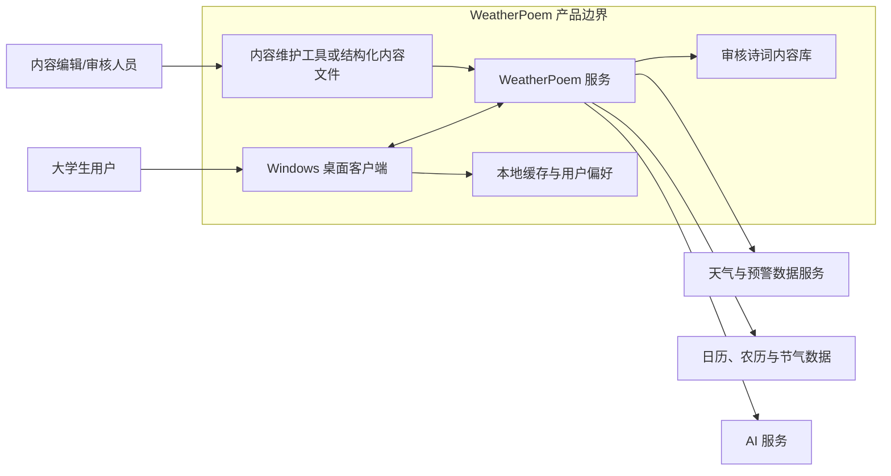
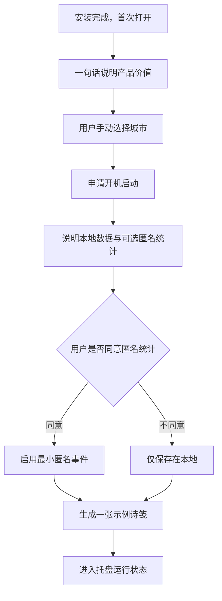
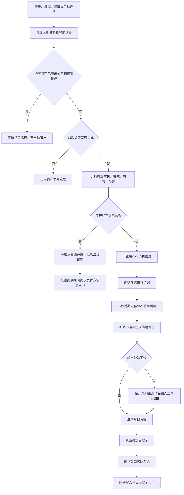
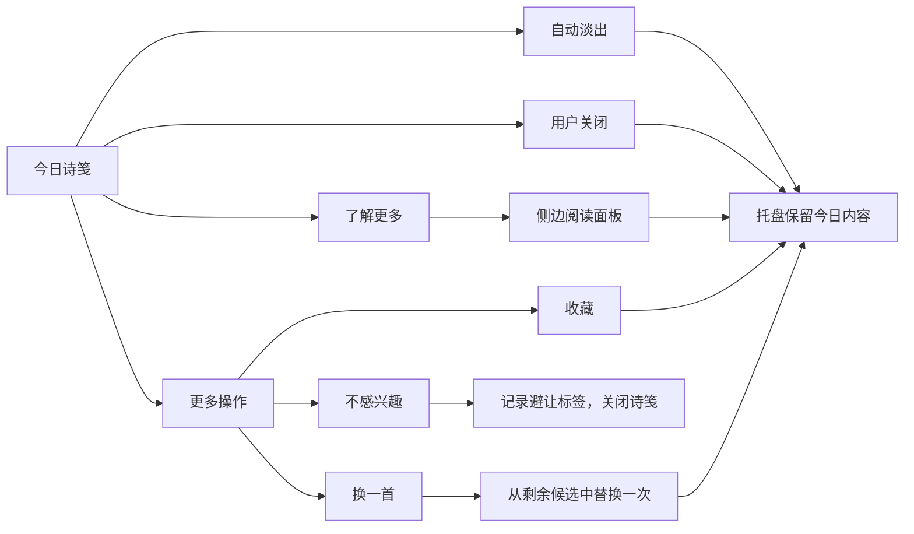
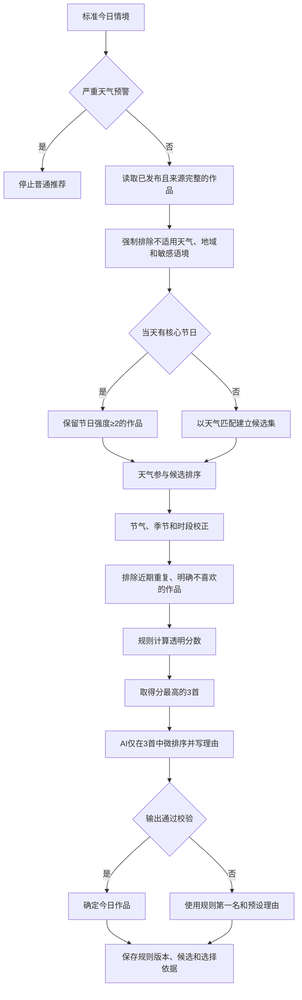
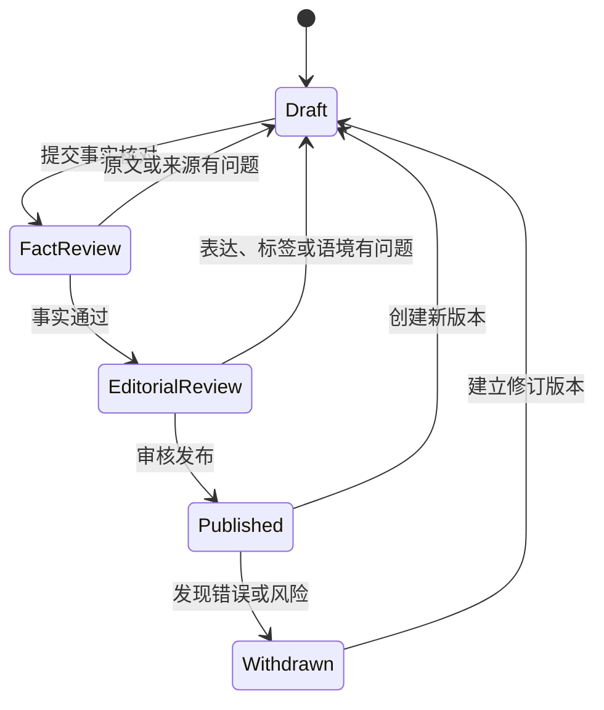
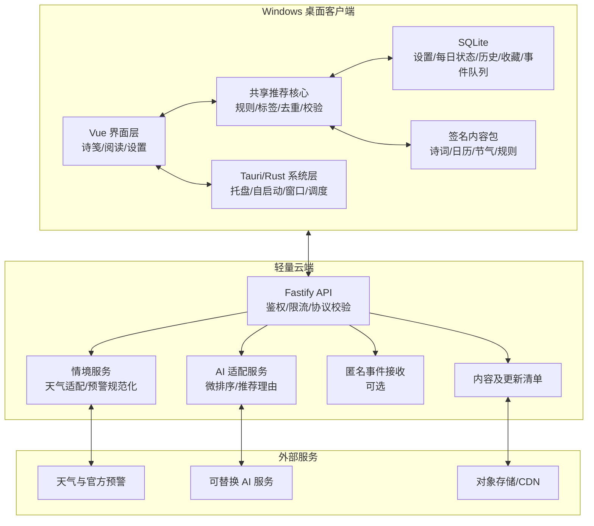
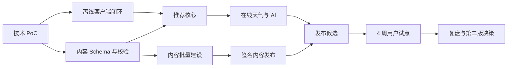

# WeatherPoem 产品设计工作稿

| 项目 | 内容 |
|---|---|
| 文档状态 | 持续设计中 |
| 当前版本 | v0.3 |
| 目标平台 | Windows 10/11（MVP） |
| 首要用户 | 在校大学生 |
| 当前阶段 | 0.2.0 内部试用候选；校园试点前门禁关闭 |

> 本文档区分“已确认决策”“推荐假设”和“待决事项”。未经验证的数字不作为最终承诺；发生方向调整时，保留原决策及变更原因。

## 1. 执行摘要

WeatherPoem 是一个将传统文化重新带入大学生日常生活的桌面产品。

产品在用户每天第一次打开电脑后，以不抢焦点、无声音、低信息密度的“今日诗笺”，推荐一首与当天节日、当地天气和当前节气相关的诗词。用户可以在几秒内读完，也可以主动打开扩展阅读，了解完整原文、可靠出处、文化背景以及作品与当代生活的联系。

MVP 首先验证的不是内容数量，而是：

> 大学生是否愿意长期保留一个每天出现一次、不会明显打扰自己、偶尔能够产生文化共鸣的桌面入口。

## 2. 用户、问题与价值

### 2.1 首要用户

- 在校大学生。
- 接受过基础语文教育，能够理解常见古典诗词。
- 进入大学后，考试、课堂和教师提供的持续文化触点减少。
- 并非排斥传统文化，而是缺少自然、低成本的接触机会。

### 2.2 核心问题

传统文化内容通常存在于教材、展馆、专题活动和内容平台中，需要用户主动寻找并投入较多时间。它与天气变化、节日感受、离家求学和校园生活等日常情境之间缺少稳定连接。

### 2.3 用户价值

- 无需安排专门学习时间，每天自然接触一则传统文化内容。
- 诗词与“今天、这里、此刻”有关，而不是随机推送。
- 第一眼足够轻，产生兴趣后又能获得可信的扩展内容。

## 3. MVP 目标与验证假设

建议先在 30—50 名大学生中连续试用 4 周。

| 维度 | 初步验证门槛 | 证据 |
|---|---:|---|
| 内容送达 | 应推送日期成功生成诗笺 ≥95% | 客户端匿名运行记录 |
| 不打扰 | 抢焦点、重复自动弹出次数为 0 | 自动化测试与用户反馈 |
| 内容准确 | 原文、作者、篇名、出处事实错误为 0 | 内容审核与抽样复核 |
| 情境相关 | “与今天不相关”反馈 <10% | 卡片反馈数据 |
| 深入意愿 | “了解更多”点击率 ≥15% | 匿名行为数据 |
| 长期接受 | 4 周后仍保留插件及自启动 ≥40% | 试点结束检查 |
| 主观体验 | 认为产品不会明显打扰 ≥85% | 结束问卷 |

以上数字是试点假设，应在真实用户测试后复审。

## 4. 关键产品决策记录

| 编号 | 决策 | 状态 | 主要原因 | 复审触发 |
|---|---|---|---|---|
| PD-01 | MVP 采用 Windows 桌面托盘应用 | 推荐假设 | 与每日开机触发场景一致，首版范围可控 | 安装或自启动授权严重影响试用 |
| PD-02 | 每个自然日自动展示一次 | 已确认 | 建立日常接触，同时控制打扰 | 用户认为频率过高或大量错过 |
| PD-03 | 主卡片只展示一首诗 | 已确认 | 降低视觉疲劳和选择负担 | 用户普遍希望在主卡片获得更多选择 |
| PD-04 | 节日＞天气＞节气 | 已确认 | 节日主题明确，天气贴近当下，节气校正季节 | 节气长期没有存在感 |
| PD-05 | AI 不生成或改写诗词原文 | 推荐假设 | 保证文化内容准确、可追溯 | 暂无放宽计划 |
| PD-06 | AI 负责候选排序和简短推荐理由 | 推荐假设 | 利用语境表达能力，同时限制事实风险 | 理由持续错误、重复或成本不可接受 |
| PD-07 | MVP 使用用户手动确认的城市 | 推荐假设 | 城市级天气已够用，减少定位权限和误差 | 用户跨城使用频繁 |
| PD-08 | 严重天气预警时暂停普通诗意弹窗 | 已确认 | 避免灾害浪漫化和不合时宜表达 | 接入可靠且合规的预警呈现体系 |
| PD-09 | MVP 与四周校园试点不接入实时新闻；试点后仅考虑人工策展的重要事件专题 | 已确认 | 保留“当下事件连接传统文化”的长期愿景，同时控制时效、立场、来源和审核风险 | 四周试点通过，且具名编辑、双人审核、自动过期、撤回和安全抑制能力均已具备 |

## 5. 产品范围

### 5.1 MVP 范围内

1. 首次设置城市、开机启动和隐私说明。
2. 每日首次登录后的后台调度与一次性展示。
3. 节日、天气、节气和气象预警情境获取。
4. 经过人工审核并带结构化标签的诗词内容库。
5. 规则筛选、近期去重、AI 排序和理由生成。
6. 今日诗笺、系统托盘入口和扩展阅读面板。
7. 收藏、换一首和不感兴趣。
8. 网络、天气服务和 AI 服务异常时的降级。
9. 内容审核、版本和来源追踪。
10. 支撑 MVP 验证的最小匿名统计。

### 5.2 MVP 范围外

- 实时新闻、自动热点判断和未经人工双人审核的重要事件推荐；人工策展专题属于试点后的独立能力，不属于当前 MVP。
- 评论、社区、排行榜、打卡和积分。
- AI 创作古诗或改写原文。
- 短视频、直播和系统化课程。
- 完整天气预报、出行建议和节气养生建议。
- 用户投稿、内容公开发布和复杂审核工作流。
- 会员、付费、广告和商业化。
- 多设备同步和复杂账号体系。
- macOS、Linux、移动端和网页端。
- 精确位置、校园定位和持续后台定位。

### 5.3 后续重要事件能力边界

重要事件不是新的实时数据源，而是试点后才可能启用的稀少编辑覆盖层。

- 准入：只接受事实稳定、来源可定位、与传统文化存在自然连接的文化、纪念、教育和公共知识事件。
- 审核：每个专题必须由具名编辑提交，并由不同的具名审核人批准；必须设置开始、过期和撤回条件。
- 优先级：有效专题存在时使用“人工批准的重要事件专题 ＞ 节日 ＞ 天气 ＞ 节气”；没有专题时仍使用“节日 ＞ 天气 ＞ 节气”。
- 安全：严重天气或公共安全抑制状态下，普通诗笺和重要事件专题都暂停。
- AI：AI 不读取原始新闻，不判断事件是否可以发布，只能在人工批准的候选诗词中排序并生成不超过 40 字的理由。
- 界面：主卡片仍只展示一首诗和低显著度专题标签；事件摘要、来源与文化连接放入“了解更多”，事件背景默认折叠。
- 生命周期：专题到期或撤回后不得继续展示；服务失败时直接回到现有节日、天气、节气逻辑。
- 上线门禁：四周试点完成后，还需通过编辑审核、自动过期、撤回、缓存防回退、安全抑制和非开发人员 UAT，才允许小范围启用。

完整后续设计见 `docs/superpowers/specs/2026-07-24-curated-important-events-design.md`。

## 6. 系统上下文与边界



### 6.1 产品负责

- 在获得用户授权后随系统启动。
- 控制每日自动展示次数和展示时机。
- 将外部日期、天气数据转换成标准情境。
- 从审核内容库中选择文化内容。
- 校验 AI 输出长度、事实引用和表达边界。
- 提供阅读、收藏、反馈、缓存和降级体验。
- 标明诗词作者、篇名和来源。

### 6.2 产品不负责

- 代替专业天气预报和灾害预警系统。
- 判断新闻真实性或自动形成社会事件立场。
- 提供医疗、养生、出行和安全决策建议。
- 证明所有历史解释只有一种观点。
- 在没有可靠来源时自动补全诗词或文化事实。
- 未经同意收集精确位置或桌面内容。

## 7. 角色与权限

| 角色 | 允许操作 | 数据范围 | 高风险动作 |
|---|---|---|---|
| 普通用户 | 查看诗笺、展开阅读、收藏、换一首、不感兴趣、修改城市和启动设置 | 本人本地偏好及公开文化内容 | 清除全部本地数据 |
| 内容编辑 | 新建和修改诗词资料、标签、解释及预设理由 | 内容库草稿 | 修改原文、作者、出处 |
| 内容审核 | 审核、驳回、发布和撤回内容版本 | 全部内容及来源证据 | 发布、撤回、批量修改 |
| 运营/研究 | 查看匿名聚合指标和反馈趋势 | 不含精确位置和桌面内容的汇总数据 | 导出细粒度行为数据 |
| 系统维护 | 配置服务、查看脱敏日志、处理故障 | 运行状态和脱敏技术数据 | 访问生产配置与密钥 |

MVP 若由小团队完成，可以由同一人员兼任多个角色，但“内容录入”和“发布确认”应保留两个步骤。

## 8. 模块职责

| 模块 | 主要职责 | 输入 | 输出 | 失败时处理 |
|---|---|---|---|---|
| 启动与每日调度 | 自启动、每日去重、展示时机控制 | 系统登录、日期、本地状态 | 当日推荐任务 | 保留托盘入口，不重复打扰 |
| 情境聚合 | 获取并标准化节日、天气、节气和预警 | 城市、日期、外部接口 | 今日情境对象 | 按节日→节气→缓存逐级降级 |
| 内容库 | 保存诗词事实、标签、来源和预设解释 | 审核内容 | 可检索候选作品 | 不返回未发布内容 |
| 推荐引擎 | 优先级筛选、适配、去重和排序 | 今日情境、候选内容、近期记录 | 一首确定作品 | 使用规则默认结果 |
| AI 解释 | 候选微排序、生成 40 字以内理由 | 结构化事实 | 推荐理由 | 使用人工预设理由 |
| 输出校验 | 检查作品引用、禁用表达、长度和结构 | AI 输出、内容事实 | 可展示内容 | 拒绝输出并降级 |
| 诗笺交互 | 展示主卡片、淡出和用户动作 | 当日内容 | 阅读与反馈事件 | 不阻断桌面使用 |
| 扩展阅读 | 提供全文、出处、背景和当代连接 | 内容详情 | 深度阅读页面 | 缺失字段不发布 |
| 本地数据 | 城市、设置、缓存、收藏和近期记录 | 用户操作 | 本地状态 | 可由用户一键清除 |
| 最小统计 | 记录送达、展开、反馈和异常 | 匿名事件 | 聚合验证数据 | 不影响核心体验 |

## 9. 外部依赖与准入条件

| 依赖 | 用途 | 必须满足 | 降级方案 |
|---|---|---|---|
| 天气与预警服务 | 获取城市天气和严重天气状态 | 城市覆盖、时间戳、稳定性、缓存许可清晰 | 不使用过期天气，退化为节日和节气 |
| 日历/农历/节气数据 | 判断传统节日和节气 | 日期准确、支持 Asia/Shanghai、可离线校验 | 客户端内置年度日历数据 |
| 诗词资料来源 | 原文、作者、篇名和出处 | 来源可追溯、允许产品使用、可人工复核 | 未核实内容不入库 |
| AI 服务 | 候选微排序和理由生成 | 结构化输出、超时控制、成本可控 | 规则排序和人工预设理由 |
| Windows 系统能力 | 自启动、托盘、窗口和本地存储 | 不抢焦点、可撤销授权、兼容主流缩放 | 用户手动打开应用 |

在技术选型前，应分别验证天气数据授权、诗词及解释内容的使用权和 AI 数据处理条款。

## 10. 数据与隐私边界

### 10.1 MVP 可以保存

- 用户主动选择的城市。
- 是否启用开机启动。
- 今日是否已经自动展示。
- 收藏和不感兴趣记录。
- 近期推荐作品 ID。
- 经过用户同意的匿名送达、展开和反馈事件。

### 10.2 MVP 不应收集

- 精确经纬度和持续定位轨迹。
- 用户桌面截图、文件、窗口标题和输入内容。
- 与核心功能无关的设备标识。
- 学校、院系、真实姓名、手机号等身份信息。
- 可恢复出具体个人阅读轨迹的运营导出数据。

## 11. 当前需求追踪矩阵

| 编号 | 用户需求 | 产品响应 | 模块 | 验收证据 |
|---|---|---|---|---|
| R-01 | 打开电脑就能自然接触传统文化 | 每日首次登录后自动展示诗笺 | 启动与每日调度 | 同一自然日自动展示次数 ≤1 |
| R-02 | 不产生视觉疲劳 | 一张轻量卡片、一首诗、无声音、不抢焦点 | 诗笺交互 | 焦点测试、信息密度检查 |
| R-03 | 感兴趣时能够深入了解 | 渐进式扩展阅读 | 扩展阅读 | 必填内容完整且可访问 |
| R-04 | 内容与当天生活有关 | 节日、天气、节气联合推荐 | 情境聚合、推荐引擎 | 典型场景用例通过 |
| R-05 | 文化信息准确可信 | 审核库、来源记录、AI 受限使用 | 内容库、输出校验 | 原文、作者、出处错误为 0 |
| R-06 | 外部服务失败仍可使用 | 缓存、规则和预设理由 | 全部核心模块 | 断网、超时和 AI 故障测试通过 |
| R-07 | 严重天气下表达得体 | 暂停普通诗意弹窗 | 情境聚合、每日调度 | 预警场景不展示普通诗笺 |
| R-08 | 尊重位置与使用隐私 | 城市级手动设置、最小数据收集 | 本地数据、最小统计 | 未授权时无敏感数据上传 |

本节记录用户需求到产品响应的稳定基线。实施阶段的完整“需求—证据—责任人—
里程碑”追踪表位于 `review/requirements-traceability.json`，生成状态位于
`output/WeatherPoem_0.2.0_READINESS.json`，执行说明见
`docs/PROJECT_READINESS.md`。三级门禁明确区分未签名内部试用、校园试点和正式
公开发布，任一自动测试通过都不能替代具名人工或外部证据。

## 12. 待决事项

| 编号 | 待决事项 | 当前推荐假设 | 最晚关闭阶段 |
|---|---|---|---|
| O-01 | MVP 是课程/竞赛原型还是持续运营产品 | 先按可真实试用的 MVP 设计 | 技术方案前 |
| O-02 | 诗词、注释和译文的具体来源及使用权 | 原文与事实逐条记录来源，解释优先自编 | 内容入库前 |
| O-03 | 天气与预警供应商 | 先做供应商适配层，不绑定单一服务 | 技术开发前 |
| O-04 | AI 服务部署方式和预算 | 支持可替换服务，必须有无 AI 降级 | 技术开发前 |
| O-05 | 是否需要账户和云同步 | MVP 不需要账户 | 用户试点后 |
| O-06 | 匿名统计的具体范围和保存期限 | 只保留 MVP 指标所需事件 | 试点发布前 |

## 13. 下一阶段

下一阶段将完成：

1. 首次使用流程。
2. 每日自动推荐主流程。
3. 查看详情、收藏、换一首和不感兴趣流程。
4. 断网、定位失败、AI 超时、内容缺失和严重天气异常流程。
5. 客户端关键状态及每日去重状态机。
6. 对应功能清单和可验证验收条件。

## 14. 核心用户流程

### 14.1 首次使用



首次流程要求：

- 不要求注册和登录。
- 城市必须由用户确认，不能只依赖 IP 推断。
- 拒绝开机启动后，应用仍可手动运行。
- 拒绝匿名统计不能影响任何核心功能。
- 示例诗笺必须明确标识为“示例”，不计入当日自动展示次数。
- 整个流程最多包含 4 个主要页面，不加入兴趣问卷。

### 14.2 每日自动推荐

“每日首次进入可用桌面”定义为：

- 当天第一次登录 Windows；或
- 电脑跨越自然日未关机，当天第一次解锁或唤醒；或
- 当天尚未展示，用户第一次手动启动应用。

同一自然日内后续休眠唤醒、锁屏解锁和应用重启均不再次自动展示。



关键约束：

- 外部数据应并行获取，不能串行拖延展示。
- 任一非关键外部服务失败时必须降级，不能让启动流程无限等待。
- “今日已展示”只能在卡片实际渲染成功后写入。
- 若应用在渲染前退出，下次启动允许再次尝试；渲染后退出不得重复展示。
- 卡片建议在桌面可用后 15—30 秒出现。
- 卡片不抢焦点、不置顶遮挡全屏应用、不播放声音。
- 用户将鼠标移入卡片时，自动淡出计时暂停。

### 14.3 诗笺阅读与关闭



交互规则：

- 自动淡出和手动关闭都不退出应用。
- 今日诗笺始终可以从托盘重新打开。
- “不感兴趣”只记录作品和主要情境标签，不要求填写原因。
- MVP 每日允许主动“换一首”一次，避免形成无限内容流。
- 换出的作品当天不再重新出现。
- 收藏保存在本地；无账号时不承诺跨设备同步。

### 14.4 扩展阅读

扩展阅读采用右侧面板，不默认全屏。内容顺序固定：

1. 为什么今天推荐。
2. 完整原文、作者、朝代和来源。
3. 一句读懂。
4. 文化背景。
5. 与当代大学生活的联系。
6. 生僻字读音和必要注释。

默认展开前两项，其余由用户主动展开。缺少原文、作者、篇名或来源的内容不允许发布。

## 15. 客户端每日状态机

| 状态 | 含义 | 允许进入 | 退出条件 |
|---|---|---|---|
| NOT_CONFIGURED | 首次设置未完成 | 首次启动、设置被清除 | 城市及必要设置保存 |
| IDLE | 今日任务尚未开始 | 新自然日、启动完成 | 收到每日触发 |
| PREPARING | 正在获取情境和准备内容 | IDLE | 内容就绪、预警暂停或不可恢复失败 |
| READY_TO_SHOW | 诗笺已经生成，等待合适展示时机 | PREPARING | 窗口开始渲染 |
| RENDERING | 卡片正在创建和绘制 | READY_TO_SHOW | 渲染确认或失败 |
| SHOWN | 今日卡片已经实际展示 | RENDERING | 自动淡出或用户操作 |
| RETAINED | 今日内容仅保留在托盘 | SHOWN | 新自然日到来 |
| ALERT_SUPPRESSED | 因严重天气预警暂停普通诗笺 | PREPARING | 新自然日到来 |
| RETRYABLE_FAILURE | 渲染前发生可恢复故障 | PREPARING、RENDERING | 同日下次启动重试或新自然日 |

状态规则：

- `SHOWN` 写入必须和实际渲染确认关联，避免“用户没看到但系统认为已展示”。
- `SHOWN`、`RETAINED` 和 `ALERT_SUPPRESSED` 状态下，同日触发不得再次自动弹出。
- 跨自然日后重置为 `IDLE`，但保留近期推荐记录。
- 时间由系统本地时区判断；用户修改系统时间时，应避免同一日期重复展示。

## 16. 异常与降级流程

| 异常 | 系统行为 | 用户感知 | 是否计为已展示 |
|---|---|---|---|
| 天气接口超时 | 不使用过期天气，按节日和节气推荐 | 推荐理由不提实时天气 | 卡片渲染后计入 |
| 日历接口失败 | 使用客户端内置年度节日/节气数据 | 无明显感知 | 卡片渲染后计入 |
| AI 超时或输出不合格 | 使用规则首选和人工预设理由 | 无明显感知 | 卡片渲染后计入 |
| 网络完全断开 | 使用本地日历、缓存内容和预设理由 | 可显示“离线内容”弱提示 | 卡片渲染后计入 |
| 城市未设置或记录损坏 | 不使用天气，提示用户在托盘中修正城市 | 卡片可按节日/节气生成 | 卡片渲染后计入 |
| 诗词候选为空 | 使用与当前季节匹配的安全兜底内容 | 不展示错误情境说明 | 卡片渲染后计入 |
| 严重天气预警 | 暂停普通诗笺，托盘提供安全提示 | 无诗意弹窗 | 计为当日已暂停 |
| 卡片渲染前崩溃 | 不写入已展示，允许同日再尝试 | 可能暂时没有卡片 | 否 |
| 卡片渲染后崩溃 | 已写入展示记录，不重复弹出 | 托盘可在恢复后查看 | 是 |
| 设备处于演示/全屏/专注状态 | 延迟展示，超时后仅保留托盘 | 不遮挡演示或游戏 | 仅实际展示后计入 |

## 17. MVP 功能清单

优先级定义：

- P0：缺少时核心闭环无法成立。
- P1：应进入 MVP，但可以在核心闭环稳定后完成。
- P2：试点后根据证据决定。

| 编号 | 功能 | 优先级 | 核心验收 |
|---|---|---:|---|
| F-01 | 首次设置与城市确认 | P0 | 无账号可完成；城市可以修改 |
| F-02 | 开机启动申请与撤销 | P0 | 用户可拒绝和随时关闭 |
| F-03 | 每日触发与同日去重 | P0 | 同一自然日自动展示不超过一次 |
| F-04 | 节日、天气、节气情境聚合 | P0 | 能生成带时间戳的标准情境对象 |
| F-05 | 严重天气预警抑制 | P0 | 预警用例不展示普通诗意卡片 |
| F-06 | 审核诗词库读取 | P0 | 未发布或缺少来源的内容不可进入候选 |
| F-07 | 规则筛选与近期去重 | P0 | 不返回语境冲突或近期重复作品 |
| F-08 | AI 理由生成及校验 | P0 | 超时或校验失败自动使用预设理由 |
| F-09 | 今日诗笺 | P0 | 无声音、不抢焦点、信息不溢出 |
| F-10 | 托盘入口与今日内容恢复 | P0 | 卡片关闭后仍能重新打开 |
| F-11 | 扩展阅读 | P0 | 原文、作者、篇名和来源完整 |
| F-12 | 本地缓存与离线兜底 | P0 | 断网仍能生成基础诗笺 |
| F-13 | 收藏 | P1 | 本地保存、取消和查看 |
| F-14 | 不感兴趣 | P1 | 当天不再出现，影响后续避让 |
| F-15 | 每日换一首 | P1 | 每日最多主动替换一次 |
| F-16 | 设置与本地数据清除 | P1 | 用户可以查看并清除全部本地记录 |
| F-17 | 最小匿名统计 | P1 | 未同意时不发送；失败不影响产品 |
| F-18 | 内容维护与发布工具 | P1 | 支持草稿、审核、发布、撤回和来源记录 |
| F-19 | 深浅主题跟随系统 | P1 | 深色模式下可读且不刺眼 |
| F-20 | 固定到桌面 | P2 | 仅在用户研究证明有需求后加入 |
| F-21 | 账号和云同步 | P2 | 不进入首次试点 |
| F-22 | macOS 客户端 | P2 | Windows MVP 验证后再评估 |

## 18. 首轮典型验收场景

| 场景 | 输入 | 预期 |
|---|---|---|
| 普通春日 | 无节日、小雨、谷雨 | 推荐暮春或春雨作品，理由联系小雨和生长 |
| 中秋雨夜 | 中秋、小雨、秋分附近 | 中秋决定主题，雨夜和思乡参与选诗 |
| 小雪但南方温暖 | 无节日、晴暖、小雪节气、广州 | 不声称正在下雪，以真实天气为准 |
| 同日二次唤醒 | 今日已经展示、电脑再次解锁 | 不自动弹出，托盘保留内容 |
| 电脑跨夜未关机 | 昨日已展示、次日首次解锁 | 触发新一天推荐 |
| AI 服务不可用 | 情境和候选正常、AI 超时 | 使用预设理由并正常展示 |
| 完全离线 | 无网络、本地缓存可用 | 使用本地日历和缓存作品展示 |
| 暴雨预警 | 当地存在严重预警 | 不展示普通诗意弹窗 |
| 用户正在演示 | PowerPoint 全屏或系统专注状态 | 延迟或仅保留托盘，不遮挡 |

## 19. 本阶段新增待决事项

| 编号 | 待决事项 | 当前推荐假设 | 验证方式 |
|---|---|---|---|
| O-07 | 每日触发是否包含跨日后的首次解锁 | 包含，否则长期不关机用户会漏掉 | 试点观察重复与漏达 |
| O-08 | “换一首”次数 | MVP 每日一次 | 观察使用率和内容消费倾向 |
| O-09 | 全屏/专注状态最长延迟时间 | 只延迟，不在退出全屏时突然抢出；超时转托盘 | 可用性测试 |
| O-10 | 严重预警等级映射 | 依赖供应商标准并建立统一映射 | 供应商选型时关闭 |

## 20. 下一阶段

下一阶段将把推荐能力从“流程描述”落实为可执行规则：

1. 统一诗词内容模型及字段字典。
2. 节日、天气、节气、地域、情绪和难度标签体系。
3. 候选筛选、冲突排除、近期去重和排序规则。
4. AI 输入输出协议、提示约束和失败校验。
5. 内容录入、双人审核、版本和撤回流程。
6. 典型推荐样例及反例。

## 21. 首版内容范围

主推荐内容限定为中国古典诗、词，以及少量适合轻阅读的曲。主卡片展示一至两句可以独立理解的原文，扩展阅读展示完整作品。

首版不进入主推荐的内容：

- AI 仿写或现代人仿古创作。
- 现代诗和仍受著作权保护的作品。
- 未确认版本、作者或出处的网络名句。
- 只有养生、占候或迷信解释而缺少文学价值的内容。
- 需要大段前置知识才能避免误解的作品。
- 可能造成严重性别、地域或群体冒犯且无法通过背景说明妥善呈现的内容。

建议 MVP 建立 120—200 首审核作品。作品通过多标签复用，不为节日、天气和节气分别建设重复内容库。

最低覆盖要求：

| 情境 | 最低内容覆盖 |
|---|---:|
| 8 个核心传统节日 | 每个至少 6—10 首适配作品 |
| 9 类天气情境 | 每类至少 12 首可用作品 |
| 24 个节气 | 每个至少 3 首强相关或季节适配作品 |
| 春夏秋冬 | 每季至少 25 首可用作品 |
| 通用安全兜底 | 每季至少 5 首不依赖具体天气的作品 |

同一作品可以计入多个覆盖项，但必须分别记录适用强度和推荐依据。

## 22. 诗词内容模型

### 22.1 事实层

事实层字段必须有可靠来源，AI 不得修改。

| 字段 | 必填 | 说明 |
|---|---:|---|
| work_id | 是 | 作品稳定唯一 ID |
| version | 是 | 内容版本号 |
| status | 是 | draft/reviewed/published/withdrawn |
| title | 是 | 标准篇名 |
| literary_form | 是 | 诗、词、曲 |
| author_name | 是 | 标准作者名 |
| dynasty | 是 | 朝代或年代 |
| full_text | 是 | 经校对的完整原文 |
| card_excerpt | 是 | 主卡片展示的一至两句 |
| source_name | 是 | 校勘或核对来源名称 |
| source_locator | 是 | 书目、卷次、页面或稳定链接 |
| text_notes | 否 | 版本异文和选择理由 |
| evidence_checked_at | 是 | 最近核对时间 |
| evidence_checked_by | 是 | 核对人员或流程记录 |

### 22.2 编辑层

编辑层由项目团队独立撰写，不直接复制现代注释和赏析。

| 字段 | 必填 | 约束 |
|---|---:|---|
| one_line_summary | 是 | 一句话读懂，建议 30—60 字 |
| cultural_background | 是 | 只写理解作品所需背景 |
| contemporary_connection | 是 | 与大学生活的自然联系，避免说教 |
| annotations | 按需 | 仅解释真正影响理解的词和典故 |
| fallback_reason | 是 | AI 不可用时的安全推荐理由 |
| regional_note | 按需 | 民俗或自然现象存在地域差异时必须填写 |
| sensitive_note | 按需 | 悼亡、战争、灾害等语境说明 |

### 22.3 标签层

| 标签组 | 示例 | 用途 |
|---|---|---|
| festival_tags | 春节、中秋、重阳 | 决定节日主题适配 |
| weather_tags | 小雨、晴朗、寒冷、雪 | 匹配当日天气感受 |
| excluded_weather | 暴雨预警、台风、极端高温 | 强制排除不合时宜内容 |
| solar_term_tags | 谷雨、白露、霜降 | 校正节令意境 |
| season_tags | 春、夏、秋、冬 | 基础季节约束 |
| time_tags | 清晨、白昼、黄昏、夜晚、通用 | 匹配用户阅读时段 |
| emotion_tags | 欣喜、宁静、思乡、孤独、旷达、坚韧 | 控制情绪和连续内容多样性 |
| life_tags | 离家、友情、成长、考试、毕业、归乡 | 支撑当代生活连接 |
| place_tags | 江南、边塞、山水、城市或具体地点 | 避免地域误配 |
| difficulty | 基础、进阶 | 控制日常阅读负担 |
| sensitivity_tags | 悼亡、战争、灾害、酒、宗教 | 语境审核和风险避让 |

每个正向适配标签同时记录强度：

- 3：作品的核心主题或明确描写。
- 2：直接相关，适合作为主要推荐依据。
- 1：弱相关，只能作为辅助排序因素。
- 0：无明确关联。

## 23. 标准今日情境对象

推荐引擎只接收经过标准化的结构化数据，不直接处理天气服务的自然语言返回。

```json
{
  "context_id": "2026-07-23_hangzhou",
  "local_date": "2026-07-23",
  "local_time_period": "day",
  "timezone": "Asia/Shanghai",
  "city_code": "hangzhou",
  "city_name": "杭州",
  "festival": null,
  "weather_primary": "light_rain",
  "weather_modifiers": ["cool"],
  "weather_observed_at": "2026-07-23T09:00:00+08:00",
  "weather_warning": null,
  "solar_term": "great_heat",
  "season": "summer",
  "recent_work_ids": [],
  "recent_author_ids": [],
  "disliked_work_ids": [],
  "disliked_tags": []
}
```

数据要求：

- 天气必须携带观测或更新时间。
- 超过供应商允许的新鲜度后，不得继续当作“当前天气”使用。
- 节日和节气由确定性日历规则产生。
- 用户反馈只参与本地避让，不建立未经同意的敏感画像。

## 24. 推荐决策管线



### 24.1 强制排除规则

出现任一条件时，作品不能进入候选：

- 状态不是 `published`。
- 原文、作者、篇名或来源不完整。
- 命中当天严重天气或安全情境的排除标签。
- 作品季节与当前节气明显冲突，且没有节日强关联提供合理解释。
- 具体地点表达会让用户误认为作品描写当前所在地。
- 用户已明确标记不感兴趣，且尚在避让期内。
- 同一作品在近 90 天内已经推荐。
- 卡片节选脱离全文后会产生明显误读。

若强制排除后没有候选，进入本季“通用安全兜底库”，不得放宽来源和安全条件。

### 24.2 多样性规则

- 同一作者原则上 7 天内不重复。
- 同一作品 90 天内不重复。
- 连续 3 天不应全部来自同一朝代或同一情绪标签。
- 收藏不自动提高同一作者的出现频率，避免过早形成内容茧房。
- “不感兴趣”先避让作品，再弱化对应标签；不因一次反馈永久排除整个主题。

以上窗口均作为初始参数，试点后根据内容量和用户反馈复审。

## 25. 规则评分

规则分数用于形成可解释候选，不追求首版使用复杂机器学习模型。

### 25.1 有节日时

| 因素 | 建议权重 |
|---|---:|
| 节日适配 | 50 |
| 天气适配 | 20 |
| 节气/季节适配 | 10 |
| 时段和地域适配 | 5 |
| 内容质量与易读性 | 10 |
| 近期多样性 | 5 |

节日适配强度低于 2 的作品不进入普通候选。

### 25.2 无节日时

| 因素 | 建议权重 |
|---|---:|
| 天气适配 | 45 |
| 节气/季节适配 | 25 |
| 时段和地域适配 | 10 |
| 内容质量与易读性 | 10 |
| 近期多样性 | 10 |

天气不可用时，将天气权重移交给节气、季节和内容质量，不得假设天气。

### 25.3 选择日志

每次推荐至少记录以下非敏感信息，用于复现错误：

- 情境对象版本。
- 推荐规则版本。
- 内容库版本。
- 进入最终排序的作品 ID 和规则分数。
- 强制排除原因代码。
- AI 是否参与、是否降级。
- 最终作品 ID 和理由来源。

选择日志不保存完整 AI 密钥、精确位置和无关用户行为。

## 26. AI 职责与协议

### 26.1 AI 可以做

- 在规则产生的最多 3 首候选中进行微排序。
- 根据已提供事实，生成 40 个汉字以内的推荐理由。
- 为扩展阅读生成表达草稿，供内容审核后入库。
- 识别推荐理由是否生硬、重复或说教。

### 26.2 AI 不可以做

- 在候选集以外自行寻找诗词。
- 编造、补写、改写或纠正诗词原文。
- 推算节日、节气、天气、所在地和气象预警。
- 把节气名称当作当地实际天气。
- 生成医疗、养生、灾害应对和出行建议。
- 使用未提供的历史事实增强文案。
- 绕过内容状态、来源和安全排除规则。

### 26.3 AI 输入

AI 只接收完成当前任务所需的结构化字段：

```json
{
  "task": "rank_and_explain",
  "context": {
    "festival": "mid_autumn",
    "weather": "light_rain",
    "solar_term": "autumn_equinox",
    "city_display": "杭州",
    "time_period": "night"
  },
  "candidates": [
    {
      "work_id": "work_001",
      "title": "示例篇名",
      "author": "示例作者",
      "excerpt": "经审核的诗句",
      "approved_facts": ["与中秋相关", "包含思乡主题", "适合雨夜"]
    }
  ],
  "constraints": {
    "reason_max_hanzi": 40,
    "must_choose_from_candidates": true,
    "no_new_facts": true
  }
}
```

禁止把用户桌面内容、文件名、窗口标题和无关个人信息发送给 AI。

### 26.4 AI 输出

```json
{
  "selected_work_id": "work_001",
  "reason": "雨夜未见圆月，诗中的思乡因此更贴近今晚。"
}
```

输出必须满足：

- 是可解析的固定 JSON 结构。
- `selected_work_id` 必须属于输入候选集。
- 理由不超过 40 个汉字。
- 只使用输入中明确提供的事实。
- 不增加第二首诗、标题、作者或引文。
- 不包含养生、安全、医疗或行动建议。
- 不使用夸张营销和说教语气。

MVP 校验失败时不进行多轮自由修复，直接采用规则第一名和人工预设理由，以控制延迟和不可预测性。

## 27. 推荐理由表达规范

推荐理由应回答“为什么是今天”，而不是复述诗句。

推荐表达：

- 具体说明今天的节日、天气或节令与作品的连接。
- 使用大学生日常能够自然理解的语言。
- 保持克制，不强迫用户产生某种情绪。
- 可以提到“雨夜、归家、离校、想念”等生活经验，但不能假设用户一定处于某种关系或情绪中。

避免表达：

- “穿越千年，与古人邂逅。”
- “让我们一起感受传统文化的魅力。”
- “这首诗治愈每一个孤独的灵魂。”
- “小雪已至，窗外必然雪落。”
- “今天下雨，所以为你推荐一首写雨的诗。”
- “大学生都应该学习这种精神。”

好的理由应同时满足：有当天依据、有作品依据、没有额外事实、读起来不像课程导语。

## 28. 内容审核与发布



审核清单：

1. 原文、标点、作者、篇名和朝代经过核对。
2. 来源可以定位，不能只写“来自网络”。
3. 主卡片节选没有断章取义。
4. 节日、天气和节气标签有文本依据。
5. 民俗和地域表述不被写成全国统一事实。
6. 赏析、注释和当代连接为项目自有表达或已获得授权。
7. 推荐理由不把天气、节气或用户情绪说成未经确认的事实。
8. 敏感语境和不适用天气已经标记。

MVP 允许同一项目成员先编辑后审核，但两步必须分开执行并留记录；正式运营时应由不同人员完成事实核对和发布确认。

## 29. 内容撤回与客户端更新

- 已发布内容不可直接覆盖，修订时创建新版本。
- 发现原文、作者、出处或严重表达错误时，将版本标记为 `withdrawn`。
- 客户端同步撤回清单后，不再从缓存展示该版本。
- 撤回内容若是当日推荐，托盘入口显示“内容正在校正”，不继续传播错误文本。
- 内容包和规则包均携带版本号，便于复现历史推荐。

## 30. 典型推荐样例

### 30.1 中秋雨夜

```text
节日：中秋
天气：小雨
节气：秋分附近
时段：夜晚
```

规则行为：

1. 只保留中秋适配强度 ≥2 的作品。
2. 排除只适合晴朗望月、且无法解释雨夜情境的内容。
3. 优先包含思乡、相隔、未见月等主题的作品。
4. AI 只能在规则最高的 3 首中选择并写理由。

### 30.2 谷雨小雨

```text
节日：无
天气：小雨
节气：谷雨
季节：春
```

优先方向为春雨、草木生长和暮春体验，不推荐秋夜听雨或冬日风雪作品。

### 30.3 广州小雪节气晴暖

```text
节日：无
天气：晴朗、温暖
节气：小雪
城市：广州
```

不得声称当地正在下雪。节气只用于说明冬意渐深或南北季候差异，实际天气仍以晴暖为准。

## 31. 本阶段验收

- 任一推荐可以通过情境、规则版本和内容标签复现。
- AI 关闭后，系统仍能稳定选择作品并提供合格理由。
- AI 无法选择候选集之外的作品。
- 缺少来源或处于撤回状态的内容无法进入候选。
- 同一作品 90 天内不会自动重复。
- 节气名称不会被直接解释为本地实际天气。
- 严重天气预警能在推荐前阻断普通诗笺。
- 内容错误可以通过版本撤回停止继续传播。

## 32. 下一阶段

下一阶段进入交互与视觉设计：

1. 信息架构和页面清单。
2. 今日诗笺、托盘菜单和阅读面板线框。
3. 首次设置、设置页和异常状态。
4. 字体、留白、色彩、动效和深色模式规范。
5. 低视觉疲劳和无障碍要求。
6. 可交互原型或高保真视觉稿。

## 33. 信息架构与页面清单

### 33.1 用户可见界面

| 界面 | 出现方式 | 主要任务 | 信息密度 |
|---|---|---|---|
| 首次设置 | 首次主动打开 | 确认城市、开机启动和隐私选择 | 低 |
| 今日诗笺 | 每日首次进入桌面后自动出现 | 在数秒内完成一次文化接触 | 极低 |
| 托盘菜单 | 用户主动点击托盘图标 | 重开今日内容、进入设置、退出 | 低 |
| 扩展阅读面板 | 点击“了解更多” | 阅读全文、背景和当代连接 | 中 |
| 设置 | 用户主动进入 | 修改城市、自启动、主题和数据选项 | 中 |
| 收藏 | 用户主动进入 | 回看已收藏作品 | 中 |
| 预警暂停提示 | 严重天气时替代普通诗笺 | 解释为何暂停并提供可靠来源 | 极低 |
| 错误/离线状态 | 发生异常时按需出现 | 说明降级，不阻断使用 | 极低 |

首版不设置首页、推荐信息流和每日任务中心。应用的默认入口就是当日诗笺。

### 33.2 内容层级

```text
第一层：遇见
今日情境 + 一至两句诗 + 作者篇名 + 一句推荐理由

第二层：理解
为什么今天 + 完整原文 + 可靠出处

第三层：延伸
一句读懂 + 文化背景 + 当代生活连接 + 注释
```

系统负责让用户遇见内容，用户决定是否继续深入。

## 34. 今日诗笺交互规范

| 项目 | 规范 |
|---|---|
| 建议宽度 | 392 逻辑像素 |
| 高度 | 根据内容自适应，通常 240—290 逻辑像素 |
| 位置 | 主显示器工作区右下角，避开系统任务栏 |
| 边距 | 距工作区右侧和底部 24—32 像素 |
| 主内容 | 只允许一首作品、一至两句原文 |
| 自动停留 | 10—15 秒 |
| 鼠标悬停 | 暂停自动淡出 |
| 焦点 | 不主动取得键盘焦点 |
| 声音 | 始终无声音 |
| 关闭后 | 内容保留在托盘 |
| 全屏时 | 延迟或仅保留托盘 |

主卡片固定顺序：

1. 城市、主要天气、节日或节气。
2. 一至两句诗词。
3. 作者和篇名。
4. 40 字以内推荐理由。
5. “了解更多”和低显著度更多操作。

收藏、换一首和不感兴趣收在二级菜单中，不与“了解更多”竞争视觉注意。

## 35. 视觉系统

### 35.1 设计方向

采用“安静的编辑式诗笺”，而不是天气小组件、国潮宣传页或学习软件。

核心特征：

- 暖白、骨色、墨色为主。
- 诗词使用宋体风格，界面操作使用清晰黑体。
- 依靠字号、行距和留白形成层次。
- 仅使用轻边框和极弱阴影。
- 文化感来自内容和排版，不来自龙纹、卷轴、印章堆叠。
- 不使用渐变、玻璃拟态、霓虹、轮播、自动翻页和连续动效。

### 35.2 色彩

| 用途 | 浅色模式 | 深色模式 |
|---|---|---|
| 桌面模拟背景 | `#E9E6DF` | `#22231F` |
| 诗笺表面 | `#FBFAF6` | `#292A26` |
| 主要文字 | `#24231F` | `#ECE9DF` |
| 次要文字 | `#6F6B63` | `#B9B5AA` |
| 结构边框 | 10% 墨色 | 9% 白色 |
| 文化强调 | `#8A3A32` | `#D49A90` |
| 预警强调 | `#A05321` | `#E1AA73` |

颜色只承担层级和语义，不用来制造大面积情绪氛围。

### 35.3 字体

| 内容 | 字体建议 | 大小 |
|---|---|---:|
| 主诗句 | 思源宋体、宋体或系统宋体回退 | 24—28 px |
| 作品标题 | 宋体风格 | 24—28 px |
| 完整原文 | 宋体风格 | 17—19 px |
| 普通界面文字 | MiSans、苹方、微软雅黑 | 12—14 px |
| 元数据和标签 | 系统黑体 | 10—11 px |

诗句行高建议 1.55—1.7；扩展阅读正文行高建议 1.75—1.9。

### 35.4 动效

- 卡片进入：透明度与垂直位移 10—12 像素，220 毫秒。
- 阅读面板：右侧滑入，260 毫秒。
- 菜单和按钮：160—200 毫秒颜色变化。
- 动效只使用 `transform` 和 `opacity`。
- 用户启用“减少动态效果”时，关闭非必要动画。
- 不使用持续漂浮、呼吸、闪烁和背景循环动画。

## 36. 扩展阅读规范

- 从屏幕右侧打开，建议宽度 520—560 逻辑像素。
- 不遮盖整个桌面，不创建第二个全屏学习环境。
- “为什么是今天”和“作品原文”默认展开。
- 其他内容采用无卡片嵌套的折叠段落。
- 每段只解决一个问题，避免长篇百科复制。
- 底部保留收藏操作和“今日仅自动推荐一次”的克制提示。
- 内容区域独立滚动，关闭后回到原桌面状态。

## 37. 首次设置规范

首轮设置拆成最多三个短步骤：

1. 选择并确认城市。
2. 申请开机启动。
3. 说明本地数据和可选匿名统计。

要求：

- 每页只做一个决定。
- 城市输入说明“只用于匹配天气，不需要精确位置”。
- 不使用兴趣标签问卷。
- 不把拒绝开机启动或匿名统计设计成次等按钮陷阱。
- 完成后展示一张标注为“示例”的诗笺。

## 38. 无障碍与系统适配

- 支持 Windows 100%、125%、150% 和 200% 显示缩放。
- 所有文字在深浅主题下满足可读对比度。
- 不依靠颜色单独表达状态。
- 所有图标按钮提供可读名称。
- 键盘可以访问主要操作，`Esc` 关闭菜单、面板或诗笺。
- 文本放大后允许卡片增高，不裁剪诗句和推荐理由。
- 支持系统深浅主题和减少动态效果。
- 屏幕阅读器按“情境→诗句→作者篇名→推荐理由→操作”的顺序读取。

## 39. 可交互原型

本地原型文件：

- `prototype/index.html`
- `prototype/styles.css`
- `prototype/app.js`

已实现并检查：

- 今日诗笺显示与关闭。
- 从托盘重新打开诗笺。
- 展开及关闭右侧阅读面板。
- 收藏、每日换一首和不感兴趣反馈。
- 首次城市设置。
- 严重天气预警暂停状态。
- 浅色与深色主题。
- 键盘 `Esc` 关闭层级。
- 1280×720 视口下无页面溢出。
- 浏览器控制台无错误或警告。

原型顶部的“原型场景”工具条只用于评审，不属于正式桌面产品。

## 40. 本阶段设计结论

交互设计已经落实“第一眼轻、主动后深入”：

- 主卡片没有永久占据桌面。
- 诗词而非天气数字是视觉中心。
- 文化背景不与诗句堆叠在同一空间。
- 二级操作隐藏但仍可找到。
- 预警状态不浪漫化灾害。
- 深色模式不通过纯黑和高对比制造视觉疲劳。

## 41. 下一阶段

下一阶段进入技术方案：

1. 桌面技术栈决策及备选方案。
2. 客户端、服务端、内容管理和外部适配边界。
3. 本地优先与云端能力划分。
4. 核心数据表、客户端本地存储和版本机制。
5. 天气、日历、内容和 AI 接口协议。
6. 安全、隐私、性能、更新和可观测性要求。
7. 架构决策记录及复审条件。

## 42. 技术架构结论

MVP 推荐采用：

```text
Windows 桌面端：Tauri 2 + Vue 3 + TypeScript
原生系统层：Rust
本地存储：SQLite + 版本化 JSON 内容包
云端 API：Node.js LTS + Fastify + TypeScript
内容维护：Git + 结构化 YAML/JSON + 自动校验
在线数据：天气供应商适配器 + AI 供应商适配器
发布：Windows NSIS/MSI 安装包 + 代码签名 + 签名更新
```

整体采用“本地优先、云端增强”：

- 日期、节日、节气、历史去重、内容筛选和离线推荐可以在本地完成。
- 云端负责保护天气及 AI 密钥、规范化第三方数据、AI 微排序和最小匿名统计。
- 云端不可用时，客户端仍能使用内置内容包和规则完成基础推荐。
- MVP 不建设微服务、消息队列、Redis 集群和 Kubernetes。

## 43. 框架选型比较

| 方案 | 优点 | 主要代价 | 结论 |
|---|---|---|---|
| Tauri 2 + Vue | 使用系统 WebView、包体较小；支持托盘、自启动、SQLite、更新；可复用 Web 原型；未来可扩展 macOS | 需要 Rust 和 Windows 构建工具；少量窗口行为需要 Win32 适配 | 推荐 |
| WinUI 3 + C# | Windows 原生集成最好；微软推荐的新原生 Windows 方案 | Windows 独占；现有 Web 原型不能直接复用；未来 macOS 需重写 | 深度原生需求时复审 |
| Electron | 纯 JavaScript 团队容易上手；桌面生态成熟 | 自带 Chromium 和 Node，多进程常驻成本更高 | 团队完全无法承担 Rust 时备选 |

选择 Tauri 的主要依据：

- 产品是长期后台运行的小工具，常驻资源和安装体积比复杂 Web 能力更重要。
- 界面主要由排版和轻交互构成，系统 WebView 已能满足。
- Tauri 官方提供系统托盘、自启动、单实例、SQL、窗口状态和签名更新能力。
- Windows 10 1803 及之后通常已经带有 WebView2；安装器仍需处理缺失或版本不足的情况。

## 44. 总体架构



## 45. 客户端职责

### 45.1 Vue 界面层

- 首次设置、今日诗笺、阅读面板、设置和收藏界面。
- 只处理展示状态和用户交互，不直接持有外部服务密钥。
- 所有来自本地数据库、内容包和云端的数据先通过运行时 Schema 校验。
- 不在 WebView 中加载第三方远程页面。

### 45.2 Tauri/Rust 系统层

- 单实例运行和系统托盘。
- 开机启动状态读取、申请和撤销。
- 日切、登录、解锁或唤醒后的调度。
- 无激活显示诗笺窗口，避免抢夺键盘焦点。
- 检测全屏或不适合弹出的前台状态。
- 窗口定位、多显示器工作区和 DPI 缩放处理。
- SQLite 迁移、内容包原子替换和签名校验。
- 本地日志、应用更新和安全打开官方外链。

Windows 诗笺窗口需要在 PoC 中验证：

- `WS_EX_NOACTIVATE`，显示时不激活窗口。
- `WS_EX_TOOLWINDOW`，不出现在任务切换列表。
- 工作区右下角定位，不覆盖任务栏。
- 多显示器和 100%—200% 缩放。
- 全屏应用、演示和游戏场景下延迟展示。

### 45.3 共享推荐核心

推荐规则使用 TypeScript 独立包实现，客户端和云端共同复用：

- 标准情境类型。
- 内容及标签 Schema。
- 强制排除规则。
- 透明规则评分。
- 近期去重和多样性规则。
- AI 输入输出校验。
- 推荐理由长度和禁用表达校验。

这样可以让离线与在线路径使用同一套规则，减少结果不一致。

## 46. 云端职责

云端首版保持一个可水平扩展的模块化单体，不拆微服务。

| 模块 | 职责 | 是否保存用户数据 |
|---|---|---|
| API 入口 | 协议校验、限流、请求 ID、版本兼容 | 不保存请求正文 |
| 天气适配 | 隐藏供应商密钥、缓存、标准化天气和预警 | 只使用城市代码 |
| AI 适配 | 校验候选、调用模型、校验输出、超时降级 | 不接收身份和桌面数据 |
| 内容发布 | 提供内容包、规则包和撤回清单 | 无用户数据 |
| 更新清单 | 返回客户端可用版本和签名 | 无用户数据 |
| 匿名事件 | 接收经过同意的批量事件 | 只存随机安装 ID 和最小事件 |

云端不负责：

- 保存用户收藏和完整阅读历史。
- 账号、社交关系和个性化画像。
- 直接向客户端返回未经内容库验证的诗词。
- 将第三方天气返回原样透传给界面。

## 47. 推荐仓库结构

```text
weatherpoem/
├─ apps/
│  ├─ desktop/                 # Vue 3 界面
│  │  └─ src-tauri/            # Rust 桌面系统层
│  └─ api/                     # Fastify 模块化单体
├─ packages/
│  ├─ contracts/               # API、情境和内容共享类型
│  ├─ recommendation-core/     # 确定性推荐规则
│  ├─ content-schema/          # 内容 Schema 与校验
│  └─ content-builder/         # 内容包构建、签名和撤回清单
├─ content/
│  ├─ works/                   # 结构化诗词源文件
│  ├─ authors/
│  ├─ calendar/
│  └─ rules/
├─ migrations/                # 客户端 SQLite 迁移
├─ tests/
│  ├─ scenarios/              # 典型推荐情境
│  ├─ content/                # 内容质量检查
│  └─ e2e/
└─ docs/
```

## 48. 本地数据模型

### 48.1 app_settings

| 字段 | 类型 | 说明 |
|---|---|---|
| key | TEXT PK | 设置键 |
| value_json | TEXT | 设置值 |
| updated_at | DATETIME | 修改时间 |

保存城市、开机启动偏好、主题、减少动态效果和统计授权。

### 48.2 daily_state

| 字段 | 类型 | 说明 |
|---|---|---|
| local_date | DATE PK | 本地自然日 |
| state | TEXT | idle/preparing/shown/retained/alert_suppressed |
| work_id | TEXT NULL | 当日作品 |
| content_version | TEXT NULL | 内容包版本 |
| rule_version | TEXT NULL | 推荐规则版本 |
| shown_at | DATETIME NULL | 实际渲染确认时间 |
| context_hash | TEXT NULL | 情境摘要哈希 |

### 48.3 recommendation_history

| 字段 | 类型 | 说明 |
|---|---|---|
| id | INTEGER PK | 本地记录 ID |
| local_date | DATE | 推荐日期 |
| work_id | TEXT | 作品 ID |
| author_id | TEXT | 作者 ID |
| primary_context | TEXT | 节日或天气主情境 |
| rule_score | REAL | 规则分数 |
| reason_source | TEXT | ai/fallback/offline |
| displayed | BOOLEAN | 是否实际展示 |

### 48.4 favorites

| 字段 | 类型 | 说明 |
|---|---|---|
| work_id | TEXT PK | 作品 ID |
| saved_at | DATETIME | 收藏时间 |
| content_version | TEXT | 收藏时版本 |

### 48.5 feedback

| 字段 | 类型 | 说明 |
|---|---|---|
| id | INTEGER PK | 反馈 ID |
| work_id | TEXT | 作品 ID |
| feedback_type | TEXT | dislike/replaced |
| context_tags_json | TEXT | 当日有限标签 |
| created_at | DATETIME | 创建时间 |

### 48.6 event_outbox

仅在用户同意匿名统计后使用。事件先写入本地 Outbox，批量上传成功后删除。

| 字段 | 类型 | 说明 |
|---|---|---|
| event_id | TEXT PK | 随机事件 ID |
| event_type | TEXT | delivered/opened/favorited/disliked/error |
| payload_json | TEXT | 最小事件字段 |
| created_at | DATETIME | 事件时间 |
| retry_count | INTEGER | 重试次数 |

## 49. 内容包与规则包

MVP 不先开发完整 CMS，内容使用 Git 管理：

```text
编辑结构化 YAML/JSON
→ 自动校验原文、来源、标签和重复
→ Pull Request 或双步骤评审
→ 构建只读内容包
→ 生成 SHA-256 与 Ed25519 签名
→ 发布到对象存储/CDN
→ 客户端下载到临时目录
→ 校验签名和 Schema
→ 原子替换当前版本
```

要求：

- 安装包内置一个可以离线运行的基础内容包。
- 更新失败继续使用上一有效版本。
- 内容包和规则包分别版本化。
- 撤回清单优先于内容缓存，错误作品可立即停止推荐。
- 私钥只存在于发布环境，客户端只内置公钥。
- 内容更新不执行任意代码。

## 50. 天气数据方案

### 50.1 推荐方案

生产环境优先评估和风天气一类能够同时提供以下能力的服务：

- 中国城市搜索或城市 ID。
- 实时天气。
- 官方天气预警。
- 更新时间、发布机构和归因信息。
- 明确的缓存和商业使用条款。

和风天气当前文档提供城市、实时天气和官方天气预警接口；预警返回包含发布机构、发布时间、严重程度和归因信息。但供应商明确提醒，预警字段可能发生变化，且数据可能存在延迟，因此必须做兼容解析和来源展示。

Open-Meteo 可以作为研发和基本天气数据备选，但其核心是天气模型和预报数据，不能默认等同于中国本地官方预警能力。

### 50.2 供应商适配接口

```ts
interface WeatherProvider {
  resolveCity(input: CityQuery): Promise<ProviderCity>;
  getCurrentWeather(city: ProviderCity): Promise<RawWeather>;
  getActiveAlerts(city: ProviderCity): Promise<RawAlertResult>;
}
```

业务层只接收统一模型：

```ts
interface NormalizedContext {
  observedAt: string;
  freshness: "fresh" | "stale" | "unavailable";
  weatherPrimary:
    | "sunny"
    | "cloudy"
    | "light_rain"
    | "heavy_rain"
    | "snow"
    | "fog"
    | "wind"
    | "hot"
    | "cold"
    | "unknown";
  modifiers: string[];
  warningStatus: "none" | "active" | "unknown";
  warningSeverity?: "minor" | "moderate" | "severe" | "extreme";
  warningSourceName?: string;
  warningSourceUrl?: string;
  attribution: string[];
}
```

不能把 `unknown` 当作 `none`。预警接口失败时：

- 若缓存中仍有未过期的活动预警，继续暂停普通诗笺。
- 若实时天气本身显示极端状况，退化为中性节日/节气内容，不生成浪漫化天气理由。
- 其他情况允许展示不依赖实时天气的安全内容，但不得暗示当前没有预警。

## 51. 日历与节气方案

- 节日、农历和二十四节气不依赖每日在线 API。
- 客户端内置若干年度的经过校验的日期数据，例如当前年及未来 3—5 年。
- 数据包包含时区和具体交节时间，但产品主推荐按本地自然日判断。
- 年度数据随内容包更新。
- 清明、冬至同时保留 `festival` 与 `solar_term` 标记，由优先级规则决定主主题。
- 不允许 AI 计算或猜测节气日期。

## 52. API 设计

所有时间使用 ISO 8601；服务端存 UTC，面向用户的日期按 `Asia/Shanghai` 或城市时区解释。响应包含 `request_id`、`schema_version` 和数据时间戳。

### 52.1 获取标准情境

```http
GET /v1/context?city_code=CN330100&local_date=2026-04-20
```

响应：

```json
{
  "request_id": "req_xxx",
  "schema_version": "1.0",
  "city": {
    "code": "CN330100",
    "display_name": "杭州",
    "timezone": "Asia/Shanghai"
  },
  "weather": {
    "freshness": "fresh",
    "primary": "light_rain",
    "modifiers": ["cool"],
    "observed_at": "2026-04-20T08:30:00+08:00"
  },
  "warning": {
    "status": "none",
    "attribution": ["天气数据来源名称"]
  },
  "expires_at": "2026-04-20T09:30:00+08:00"
}
```

节日和节气由客户端确定，云端只返回天气情境，减少第三方服务耦合。

### 52.2 AI 微排序和理由

```http
POST /v1/recommendations/explain
Content-Type: application/json
```

请求只包含：

- 情境字段。
- 内容包版本。
- 规则选出的最多 3 个作品 ID。
- 推荐规则版本。
- 理由字数和禁用能力。

服务端重新验证候选作品确实属于已发布内容包，AI 不能借请求注入任意原文。

响应：

```json
{
  "request_id": "req_xxx",
  "selected_work_id": "work_001",
  "reason": "谷雨时节草木正需雨水，今天的春雨正好回应了诗意。",
  "source": "ai",
  "model_policy_version": "1.0"
}
```

服务端 AI 总超时建议 2.5 秒。超时、限流或校验失败返回可识别的降级代码，客户端立即使用规则第一名和本地预设理由。

### 52.3 内容清单

```http
GET /v1/releases/content/latest?current_version=2026.04.1
```

无更新返回 `204`；有更新返回版本、下载地址、文件哈希、签名和撤回清单版本。

### 52.4 匿名事件

```http
POST /v1/events/batch
```

- 只有用户同意时发送。
- 一次最多 50 条。
- 服务端去重 `event_id`。
- 不包含完整诗词、精确位置、窗口标题和用户文件信息。
- 服务不可用时不影响推荐，客户端按上限清理积压。

## 53. 安全设计

### 53.1 客户端

- Tauri capabilities 只开放必要的托盘、自启动、SQL、更新和安全外链能力。
- WebView 使用严格 CSP，只加载本地资源，只连接固定 API 域名。
- 不启用任意 Shell 执行。
- 第三方官方页面使用系统默认浏览器打开，不嵌入应用 WebView。
- SQLite 使用参数化查询和版本迁移。
- 内容包先校验签名和 Schema，再原子替换。
- 天气、AI、统计和签名私钥不得打包进客户端。

### 53.2 服务端

- HTTPS、请求体大小限制、速率限制和 Schema 校验。
- AI 接口只接受作品 ID，不接受客户端上传的任意诗词正文。
- 供应商凭据使用密钥管理服务或部署平台 Secret。
- 日志默认脱敏，不记录完整 Authorization 和第三方密钥。
- 对天气及 AI 供应商设置超时、并发上限和熔断。
- 每个响应和外部调用携带 `request_id`。

### 53.3 分发与更新

- Windows 安装包应进行代码签名，减少 SmartScreen 信任警告。
- Tauri 更新包必须使用更新签名验证。
- 自动更新只在用户非工作关键时段提示，不静默重启。
- 内容更新可以静默下载，但替换必须原子且可回滚。
- 发布私钥不进入代码仓库和普通构建日志。

## 54. 性能与稳定性目标

| 维度 | MVP 目标 |
|---|---:|
| 后台冷启动 | P95 ≤2 秒完成本地初始化 |
| 今日内容准备 | 在线 P95 ≤5 秒；降级路径 ≤2 秒 |
| 登录到诗笺出现 | 正常在桌面可用后 15—30 秒 |
| 诗笺窗口首次绘制 | P95 ≤300 毫秒 |
| 空闲 CPU | 平均 <0.2% |
| 空闲内存 | P95 <100 MB |
| 安装包 | 不含独立 WebView2 时目标 <25 MB |
| 崩溃无感会话 | ≥99.5% |
| 同日重复自动展示 | 0 |
| AI 失败后的核心可用性 | 100% 使用本地降级 |
| 数据损坏 | SQLite 迁移和内容包更新均可回滚 |

数值需要通过首个 Windows PoC 实测，不作为未经验证的框架宣传。

## 55. 可观测性

### 55.1 客户端本地日志

- 默认滚动保留 7 天。
- 记录启动、状态转换、内容版本、作品 ID、降级原因和崩溃摘要。
- 不记录完整诗词、精确位置、桌面内容和 AI 密钥。
- 用户可以导出诊断包，也可以一键清除。

### 55.2 云端指标

- 天气供应商成功率、延迟、缓存命中和预警状态分布。
- AI 调用成功率、延迟、校验失败和本地降级率。
- 内容包下载成功率和撤回生效情况。
- 经授权的诗笺送达、展开、收藏、不感兴趣和换一首比例。
- 5xx、限流和协议版本不兼容。

### 55.3 告警

- 天气服务连续失败或预警解析错误。
- AI 校验失败率突然升高。
- 内容包签名验证失败。
- 同一内容版本出现高比例“不相关”反馈。
- 客户端新版本崩溃率明显高于上一版本。

## 56. 架构决策记录

| 编号 | 决策 | 未选择方案及原因 | 复审触发 |
|---|---|---|---|
| TD-01 | Tauri 2 作为桌面壳 | Electron 常驻成本较高；WinUI 限定 Windows | Rust 能力无法补齐或原生窗口 PoC 失败 |
| TD-02 | Vue 3 + TypeScript | 不引入第二套 UI 技术 | 团队已有强约束框架 |
| TD-03 | 本地优先、云端增强 | 纯云端在断网和 AI 故障时不可用 | 内容和规则复杂到本地无法维护 |
| TD-04 | 共享 TypeScript 推荐核心 | 客户端和服务端各写一套容易漂移 | 性能要求迫使核心迁入 Rust |
| TD-05 | Git 内容源 + 签名包 | 首版 CMS 成本过高 | 内容团队扩大、更新频率显著提高 |
| TD-06 | Fastify 模块化单体 | 微服务和消息队列对试点过重 | 独立模块需要单独扩容或团队边界形成 |
| TD-07 | SQLite 保存本地个人状态 | 账号和云同步不属于 MVP | 用户明确需要多设备同步 |
| TD-08 | 天气供应商适配层 | 直接绑定供应商会污染业务规则 | 长期只使用一个稳定自有数据源 |
| TD-09 | 二进制和内容包分别签名 | 仅依赖 HTTPS 无法覆盖发布链路风险 | 无放宽计划 |

## 57. 官方能力核对

- [Tauri 架构](https://v2.tauri.app/concept/architecture/)
- [Tauri 系统托盘](https://v2.tauri.app/learn/system-tray/)
- [Tauri 自启动插件](https://v2.tauri.app/plugin/autostart/)
- [Tauri SQL 插件](https://v2.tauri.app/plugin/sql/)
- [Tauri Windows 安装器](https://v2.tauri.app/distribute/windows-installer/)
- [Tauri 更新插件](https://v2.tauri.app/plugin/updater/)
- [Tauri Windows 前置依赖](https://v2.tauri.app/start/prerequisites/)
- [Vue TypeScript 指南](https://vuejs.org/guide/typescript/composition-api)
- [Fastify TypeScript 指南](https://fastify.dev/docs/latest/Reference/TypeScript/)
- [和风天气开发文档](https://dev.qweather.com/docs/)
- [和风天气预警文档](https://dev.qweather.com/docs/api/warning/weather-alert/)
- [Open-Meteo 天气 API](https://open-meteo.com/en/docs)

## 58. 技术 PoC 必须先验证

在进入完整开发前，先用 5—7 个工作日关闭以下技术风险：

1. Tauri 开机启动后隐藏运行且不拖慢登录。
2. 诗笺窗口不抢焦点，能在正确显示器工作区右下角显示。
3. 同日重复触发、跨日唤醒和应用崩溃后的状态正确。
4. 100%、125%、150% 和 200% 缩放下窗口位置与文字正常。
5. 全屏、演示和专注场景能够延迟或抑制。
6. SQLite 迁移、内容包签名和原子回滚可用。
7. 天气和预警接口可以稳定映射到统一情境。
8. AI 超时和无网络情况下，2 秒内进入本地降级。
9. NSIS 或 MSI 安装、卸载、自启动撤销和签名更新链路可行。

PoC 退出条件：九项均有演示或自动测试证据；任何核心项失败，应回到 TD-01、TD-03 或供应商决策复审。

## 59. 下一阶段

下一阶段进入 MVP 实施设计：

1. 里程碑、周期和每阶段退出条件。
2. 按角色拆分的工作包和依赖关系。
3. 内容、客户端、服务端、设计和测试交付物。
4. 小团队或单人＋AI情况下的执行顺序。
5. 首轮用户试点、数据收集和复盘安排。

## 60. MVP 实施总览

建议按“8 周开发与发布准备 + 4 周真实试点”规划。单人＋AI执行时预留约 20% 风险缓冲，不以压缩审核和测试换取表面进度。

| 阶段 | 周期 | 核心目标 | 退出条件 |
|---|---:|---|---|
| M0 技术风险 PoC | 1 周 | 关闭桌面窗口、自启动、存储、天气和安装风险 | 第 58 节九项均有证据 |
| M1 离线核心闭环 | 2 周 | 不依赖云端完成每日诗笺体验 | 10 首样例内容可离线完整运行 |
| M2 内容与推荐系统 | 2 周 | 建立审核内容包和确定性推荐 | 至少 120 首发布候选，规则场景测试通过 |
| M3 在线增强 | 1.5 周 | 接入天气、预警、AI及内容更新 | 所有外部服务均可超时降级 |
| M4 发布候选 | 1.5 周 | 安装、更新、性能、安全和试点准备 | P0 功能、质量门槛和发布检查通过 |
| M5 用户试点 | 4 周 | 验证不打扰、相关性和保留意愿 | 完成指标报告、访谈和 Go/No-Go |

如果 PoC 的无焦点窗口或全屏抑制失败，不进入 M1，先复审桌面技术栈。

## 61. 各阶段工作包

### 61.1 M0 技术风险 PoC

客户端：

- 初始化 Tauri 2、Vue 3 和 TypeScript 工程。
- 创建托盘、单实例和隐藏启动。
- 实现无激活诗笺窗口和右下角定位。
- 验证多显示器和 DPI 缩放。
- 建立 SQLite 并跑通第一条迁移。
- 验证系统深浅主题和减少动态效果。

外部能力：

- 用模拟数据实现天气供应商适配器。
- 调用一次候选受限的 AI 输出并执行 Schema 校验。
- 验证完全断网和 AI 超时降级。

发布：

- 生成 NSIS 或 MSI 安装包。
- 验证安装、卸载、自启动启停和签名更新流程。

交付物：

- 可运行 PoC 安装包。
- 九项风险演示记录。
- 技术栈 ADR 复审结论。
- 性能基线数据。

### 61.2 M1 离线核心闭环

- 首次设置：城市、自启动、隐私和示例诗笺。
- 每日状态机和同日去重。
- 跨日、重启、休眠和唤醒处理。
- 今日诗笺、托盘菜单和扩展阅读。
- 收藏、不感兴趣和每日换一首。
- 本地日历、节气和 10 首样例内容包。
- 确定性规则选择和人工预设理由。
- 本地日志和诊断导出。
- 浅色、深色、键盘和减少动态效果。

退出条件：

- 在断网和关闭 AI 的情况下，完整走通首次设置到次日推荐。
- 同日重复自动弹出为 0。
- 重启、跨日和渲染前崩溃状态符合状态机。
- 原型设计中的四个主要场景均已实现。

### 61.3 M2 内容与推荐系统

内容工程：

- 完成作品、作者、来源、标签和审核 Schema。
- 建立内容校验 CLI。
- 建立 Git 评审、版本和撤回流程。
- 构建、签名、校验和原子更新内容包。
- 分批录入并审核至少 120 首内容。

推荐工程：

- 节日、天气、节气和地域标准标签。
- 强制排除、规则评分、去重和多样性。
- 典型场景数据驱动测试。
- 选择日志和规则版本。
- AI 输入输出协议与本地降级。

退出条件：

- 8 个节日、9 类天气、24 节气满足最低覆盖。
- 所有发布内容均有原文、作者、篇名和来源。
- 规则可在无 AI 情况下生成稳定结果。
- 典型推荐和反例测试全部通过。

### 61.4 M3 在线增强

云端：

- 建立 Fastify 模块化单体和共享 contracts。
- 天气及预警供应商适配。
- 标准情境接口和缓存。
- AI 微排序、理由生成、超时和校验。
- 内容版本、规则版本和撤回清单接口。
- 可选匿名事件批量接收。

客户端：

- 在线/离线自动切换。
- 天气数据新鲜度判断。
- 预警 `none/active/unknown` 三态处理。
- 本地 Outbox 和用户授权控制。
- 内容包后台下载、签名验证和原子替换。

退出条件：

- 天气、AI、内容发布和统计任一服务单独失败时，核心体验仍可用。
- 客户端没有外部服务密钥。
- AI 无法选择未发布或候选集之外的作品。
- 活动预警可以在推荐前阻断普通诗笺。

### 61.5 M4 发布候选

- 完成 P0、选定 P1 及设置页。
- Windows 10/11 与多缩放比例测试。
- CPU、内存、启动、绘制和网络性能测试。
- 安装、卸载、升级、回滚和内容撤回演练。
- CSP、权限、密钥、日志和依赖安全检查。
- 键盘、屏幕阅读器和减少动态效果检查。
- 隐私说明、数据清除和诊断导出。
- 试点安装包、使用说明、反馈渠道和问题处理手册。

退出条件：

- 所有 P0 用例通过。
- 阻断级缺陷为 0。
- 原文、作者、篇名和出处错误为 0。
- 性能目标达标或偏差得到书面接受。
- 试点用户可以独立完成安装与卸载。

### 61.6 M5 四周用户试点

建议样本：

- 30—50 名在校大学生。
- 尽量覆盖不同专业、年级和城市。
- 不要求受试者是传统文化爱好者。

试点过程：

| 时间 | 行动 |
|---|---|
| 试点前 | 说明隐私、安装方式、退出和反馈渠道 |
| 第 1 周 | 观察安装、自启动、送达和明显打扰问题 |
| 第 2 周 | 观察情境相关性、展开和不感兴趣 |
| 第 3 周 | 观察内容重复、疲劳和保留行为 |
| 第 4 周 | 完成结束问卷和 6—10 人半结构访谈 |
| 试点后 | 汇总指标、问题、内容错误和功能建议 |

除修复崩溃、错误原文和严重表达问题外，试点中不频繁改变推荐规则，避免数据无法比较。算法调整记录版本和生效日期。

## 62. 工作流与依赖



关键路径是：

> 无焦点窗口 PoC → 每日状态机 → 推荐核心 → 天气/AI降级 → 安装更新 → 用户试点

内容建设与客户端开发并行，但发布候选必须等待内容审核完成。

## 63. 单人＋AI执行方式

AI 可以持续承担：

- 产品、交互、架构和测试文档。
- 工程脚手架、功能实现和自动化测试。
- 内容结构化、初步标签和解释草稿。
- 构建、诊断、缺陷定位和文档更新。

必须保留给项目发起人或真实人员的事项：

- 最终产品方向和是否公开发布。
- 天气、AI、代码签名等外部账号及费用授权。
- 诗词来源、现代解释文本和隐私条款的最终合规确认。
- 对外发布前的人工事实复核。
- 招募并取得试点用户同意。
- 对错误文化内容和用户反馈承担最终处置责任。

如果只有一名真实项目成员，该成员至少承担“项目所有者＋最终内容审核人”，AI完成其余执行草稿和技术工作。公开运营前，建议增加一名独立内容复核者。

## 64. 内容生产批次

| 批次 | 数量 | 用途 | 完成阶段 |
|---|---:|---|---|
| C0 | 10 首 | 跑通本地内容、推荐和界面 | M1 |
| C1 | 50 首 | 覆盖四季和主要天气，验证规则 | M2 前半 |
| C2 | 120 首累计 | 满足节日、天气和节气最低覆盖 | M2 结束 |
| C3 | 150—200 首累计 | 提升试点多样性和地域覆盖 | M4 或试点中 |

每批内容都必须完成事实核对、标签审核、预设理由和版本发布，不能把“录入完成”视为“可以上线”。

## 65. MVP 交付物

### 65.1 产品与设计

- 项目需求说明书。
- 需求追踪矩阵和关键决策记录。
- 用户流程、状态机和功能清单。
- 可交互原型和视觉规范。
- 隐私与数据说明。

### 65.2 内容

- 审核诗词内容包。
- 来源与事实核对记录。
- 节日、天气、节气和敏感标签字典。
- 内容审核、版本和撤回手册。
- AI 推荐理由表达规范。

### 65.3 工程

- Tauri/Vue Windows 客户端源码。
- Fastify API 源码。
- 共享推荐核心和 contracts。
- SQLite 迁移。
- 内容构建、签名和校验工具。
- Windows 安装包和更新清单。

### 65.4 质量与运营

- 单元、场景、集成和 E2E 测试报告。
- 性能、安全、安装升级和故障演练报告。
- 试点安装和卸载说明。
- 诊断、回滚和内容撤回 Runbook。
- 用户试点指标和访谈报告。

## 66. 版本计划

| 版本 | 定位 | 主要能力 |
|---|---|---|
| 0.1 PoC | 技术可行性 | 托盘、自启动、无焦点窗口、SQLite、安装 |
| 0.2 Offline Alpha | 离线产品闭环 | 每日诗笺、阅读、反馈、本地规则 |
| 0.3 Content Alpha | 内容和推荐 | 120 首内容、标签、审核、签名包 |
| 0.4 Online Beta | 在线增强 | 天气、预警、AI、内容更新 |
| 0.9 Release Candidate | 试点候选 | 性能、安全、更新、文档和质量门槛 |
| 1.0 Pilot | 四周试点 | 面向 30—50 名大学生稳定运行 |
| 1.1 Decision | 试点后决策 | 根据证据决定个性化、平台扩展、内容扩充和重要事件专题投入 |
| 1.2 Curated Context | 人工策展情境 | 门禁满足后，小范围启用具名双人审核的重要事件专题 |

## 67. 下一阶段

下一阶段完成质量和上线设计：

1. 测试分层与环境。
2. 核心功能、推荐内容、异常和系统兼容测试。
3. 性能、安全、隐私和可访问性门槛。
4. 风险登记册、预防和应急措施。
5. 试点 Go/No-Go 和最终验收标准。

## 68. 测试策略

### 68.1 测试环境

| 环境 | 用途 | 外部服务 |
|---|---|---|
| Local | 开发、单元测试、内容校验 | 全部模拟 |
| Integration | SQLite、内容包、API 合约和供应商适配 | 沙箱或录制响应 |
| Staging | 安装包、更新、真实天气和 AI 降级 | 非生产凭据 |
| Pilot | 真实用户四周试点 | 生产天气、受限 AI、正式内容包 |

测试和生产使用不同密钥、内容发布通道和事件数据集。

### 68.2 测试分层

| 层级 | 重点 | 自动化要求 |
|---|---|---|
| 单元测试 | 状态机、日切、规则评分、去重、Schema、天气映射 | 关键规则全部自动化 |
| 内容校验 | 原文、来源、标签、节选、版本和撤回 | 每次内容变更自动执行 |
| 合约测试 | 客户端/API、天气适配、AI 输出 | 每次接口变更自动执行 |
| 集成测试 | SQLite 迁移、内容包更新、超时和回滚 | CI 执行 |
| 场景测试 | 节日×天气×节气×历史记录 | 黄金情境集自动执行 |
| 桌面 E2E | 首次设置、每日展示、托盘、阅读和反馈 | 核心路径自动化＋人工复核 |
| 兼容测试 | Windows 版本、缩放、多显示器、深浅主题 | 发布候选执行 |
| 性能测试 | 启动、内存、CPU、绘制、API 延迟 | PoC 和发布候选执行 |
| 安全隐私 | 权限、密钥、CSP、签名、日志、数据清除 | 发布门禁 |
| 用户验收 | 不打扰、相关性、理解和长期接受 | 四周试点 |

代码覆盖率只作为辅助指标；状态机、安全门、推荐排除和降级路径要求场景覆盖 100%。

## 69. 核心功能测试用例

| 编号 | 场景 | 前置条件 | 预期结果 |
|---|---|---|---|
| FT-01 | 首次打开 | 无本地配置 | 进入首次设置，不要求登录 |
| FT-02 | 拒绝开机启动 | 首次设置 | 核心功能仍可手动使用 |
| FT-03 | 拒绝匿名统计 | 首次设置 | 不发送事件，不影响推荐 |
| FT-04 | 每日首次登录 | 今日未展示 | 桌面稳定后显示一次诗笺 |
| FT-05 | 同日再次解锁 | 今日已展示 | 不再次自动显示 |
| FT-06 | 跨日未关机 | 昨日已展示、次日首次解锁 | 生成新一天诗笺 |
| FT-07 | 渲染前崩溃 | 状态为 RENDERING，未确认 | 下次启动允许再次尝试 |
| FT-08 | 渲染后崩溃 | 已写入 SHOWN | 恢复后不重复弹出 |
| FT-09 | 全屏演示 | 前台全屏 | 延迟或仅保留托盘 |
| FT-10 | 关闭卡片 | 诗笺可见 | 应用继续运行，托盘可重开 |
| FT-11 | 展开阅读 | 今日内容有效 | 右侧面板显示完整必填信息 |
| FT-12 | 换一首 | 当日尚未替换 | 替换一次，原作品当日不再出现 |
| FT-13 | 重复换一首 | 当日已经替换 | 不再提供无限替换 |
| FT-14 | 不感兴趣 | 今日内容可见 | 记录避让，后续降低相关内容 |
| FT-15 | 收藏与取消 | 无账号 | 本地保存、取消和回看正确 |
| FT-16 | 清除本地数据 | 用户确认清除 | 城市、历史、收藏和事件队列被清除 |
| FT-17 | 天气接口超时 | 日历和内容可用 | 不提实时天气，仍能显示 |
| FT-18 | AI 超时 | 候选已产生 | 2 秒内使用预设理由 |
| FT-19 | 完全断网 | 本地包可用 | 完成基础推荐 |
| FT-20 | 活动严重预警 | warning=active | 普通诗笺不自动显示 |
| FT-21 | 预警状态未知 | warning=unknown | 不声称“无预警”，使用安全降级 |
| FT-22 | 内容包签名错误 | 下载被篡改 | 拒绝更新，继续旧版本 |
| FT-23 | 作品被撤回 | 缓存仍含作品 | 不再进入候选 |
| FT-24 | 应用升级失败 | 旧版本有效 | 回滚或继续旧版本，不损坏数据 |

## 70. 推荐黄金情境集

建立不可由 AI 随意改写的情境测试数据集，至少包含：

- 8 个核心节日分别与晴、雨、寒冷等典型天气组合。
- 24 个节气分别与符合和不符合名称直觉的当地天气组合。
- 9 类天气在四季中的正向和冲突作品。
- 南北城市的节气差异，例如广州小雪晴暖、哈尔滨谷雨仍冷。
- 清晨、白昼、黄昏和夜晚。
- 同一作者、朝代和情绪连续出现的多样性限制。
- 收藏、不感兴趣、近期看过和换一首。
- 预警 active、none、unknown。
- 天气缺失、AI 缺失和内容候选不足。

每条黄金情境定义：

```text
输入情境
必须排除的作品或标签
允许进入前三名的作品集合
最终理由必须包含的事实
禁止出现的事实和表达
是否允许 AI 参与
```

建议首版至少 120 条黄金情境，其中安全、预警、来源和季节冲突类全部为阻断级。

## 71. 内容质量门禁

### 71.1 自动检查

- 必填字段完整。
- `work_id`、版本和来源定位唯一。
- 主卡片节选确实存在于标准原文中，允许配置标点归一化。
- 标签值属于受控字典。
- 节日和节气强关联标签附有编辑依据。
- 撤回内容不能进入发布包。
- 预设理由符合长度和禁用表达规则。
- 同一作者、篇名和原文的疑似重复报告。
- 内容包 Schema、哈希和签名有效。

### 71.2 人工检查

- 原文、作者、篇名、朝代和出处逐条核对。
- 异文选择有说明。
- 节选不因脱离全文产生明显误导。
- 赏析和文化背景没有复制未授权现代文本。
- 民俗和物候没有被写成全国统一事实。
- 当代生活连接自然，不制造大学生刻板印象。
- 悼亡、战争、灾害、宗教和酒等敏感语境已标记。

发布门槛：

- 事实字段人工核对率 100%。
- 原文、作者、篇名和出处已知错误为 0。
- 未完成审核或来源无法定位的作品为 0。

## 72. AI 质量门禁

| 检查项 | 门槛 |
|---|---:|
| 选择候选集外作品 | 0 |
| 修改、补写或新增诗词原文 | 0 |
| 引入输入中不存在的天气、节日或历史事实 | 0 |
| 严重天气绕过安全门 | 0 |
| 结构化输出解析失败后仍直接展示 | 0 |
| 超过 40 个汉字且未经裁切/降级 | 0 |
| AI 失败后无法显示基础内容 | 0 |
| 黄金情境前三名可接受率 | ≥95% |
| 推荐理由人工“相关且自然”评价 | ≥85% |

每次模型、提示、校验器或内容包升级，都重新执行黄金情境集。模型升级不得仅依据“感觉更好”上线。

## 73. 兼容性与可访问性测试

### 73.1 Windows 矩阵

至少覆盖：

- Windows 10 22H2。
- 当前受支持的 Windows 11 主版本。
- 100%、125%、150% 和 200% 显示缩放。
- 单显示器和双显示器。
- 主显示器位于不同相对方向。
- 浅色、深色和高对比主题。
- WebView2 缺失、过旧或修复安装。
- 普通用户权限安装与运行。

### 73.2 可访问性

- 仅键盘完成首次设置、阅读、收藏和关闭。
- 焦点顺序与视觉顺序一致。
- 图标按钮都有可读名称。
- 屏幕阅读器能够读出诗句、作者、出处和操作。
- 200% 文本缩放不裁切必填信息。
- 减少动态效果时关闭非必要动画。
- 预警不只依靠橙色表达。

当前工程已完成焦点、语义、关键文字对比度、强制颜色、窄视口回流和减少动态的
自动基线，并用 215×340 CSS 视口走查首次设置、诗笺、全文、设置和官方预警，
作为 430×680 窗口 200% 缩放的布局等效观察。该观察不能替代真实 Windows
讲述人、NVDA、对比度主题、文本大小和系统 DPI 测试；执行步骤与证据要求见
`docs/ACCESSIBILITY.md`，在具名人工证据存在前 RQT-14 保持 `partial`。

## 74. 性能与资源测试

| 测试 | 方法 | 通过条件 |
|---|---|---|
| 冷启动 | 10 次干净启动取 P95 | 本地初始化 ≤2 秒 |
| 诗笺绘制 | 记录创建到首帧 | P95 ≤300 毫秒 |
| 在线准备 | 真实天气＋AI，多次采样 | P95 ≤5 秒 |
| 降级准备 | 断网、超时、AI关闭 | ≤2 秒 |
| 空闲资源 | 后台运行 8 小时 | CPU 平均 <0.2%，内存 P95 <100 MB |
| 长时间运行 | 连续 7 天跨日、休眠、唤醒 | 无重复弹出、明显泄漏和状态损坏 |
| 内容更新 | 正常、断电模拟、损坏包 | 原子切换或保留旧版本 |
| 事件积压 | 断网 7 天后恢复 | 不阻塞推荐，按上限批量发送 |

当前自动基线使用系统临时目录中的独立 SQLite 与 WebView 账户，覆盖干净启动、
已配置诗笺最终视图、托盘资源采样、受控故障矩阵和长稳采样器。绑定当前 EXE
SHA-256 `D388D9484A7B81B1039CFAA1D21CBAD178750E5375B8FBCA7D8334A8C681609A`
的正式八小时长测 `runId=33be449f01544d368baa862bdfd731b4` 已完成 480/480
次采样，launcher 与应用进程自然退出，`npm run performance:eight-hour:check`
正式门禁通过。当前短性能烟测、三类受控故障矩阵和两分钟演练已在受控空闲环境
重新生成并通过；这些证据只证明各自覆盖的短时与八小时范围。真实在线服务、官方
预警、七天跨日、休眠唤醒、内容更新、事件积压与具名签署仍未完成，详见
`docs/PERFORMANCE_VERIFICATION.md`。

## 75. 安全与隐私检查

- 客户端安装包和源码扫描不到天气、AI 和签名私钥。
- CSP 阻止未授权脚本、资源和网络地址。
- Tauri capability 只开放当前使用的窗口、托盘、自启动、安全外链与 SQL
  加载/查询/关闭/参数化写入，没有开放 Shell、任意文件系统、进程、通用 HTTP、
  全局快捷键或全局窗口权限。
- 外链只能通过允许的 `https` 来源在系统浏览器打开。
- AI 接口拒绝候选集外 ID 和任意诗词正文注入。
- API 有请求大小、频率、并发和超时限制。
- 依赖扫描中已知高危和严重漏洞为 0。
- 关闭匿名统计后，送达、展开、收藏和反馈事件不出站。
- 日志不包含精确位置、桌面信息、访问令牌和完整第三方响应。
- 清除本地数据后不可通过普通产品功能恢复。
- 内容包和应用更新被篡改时拒绝安装。

## 76. 风险登记册

| 编号 | 风险 | 概率/影响 | 预防 | 发生后处理 |
|---|---|---|---|---|
| RK-01 | 自动弹出造成打扰并被卸载 | 中/高 | 每日一次、不抢焦点、全屏抑制 | 调整触发时机，提供仅托盘模式 |
| RK-02 | 原文、作者或出处错误 | 中/高 | 可靠来源、双步骤审核、版本记录 | 立即撤回内容包并发布更正 |
| RK-03 | 推荐与天气或节气冲突 | 中/中 | 标准标签、黄金情境、地域规则 | 关闭相关规则版本并使用兜底 |
| RK-04 | 灾害被浪漫化 | 低/高 | 预警安全门、极端天气排除 | 暂停天气理由，撤回文案并复盘 |
| RK-05 | AI 编造或输出同质化 | 中/中 | 候选受限、事实白名单、严格校验 | 关闭 AI，使用预设理由 |
| RK-06 | 天气服务不稳定或字段变化 | 中/中 | 适配层、兼容解析、超时和缓存 | 降级到节日/节气，切换供应商 |
| RK-07 | API 密钥被滥用导致成本增长 | 中/中 | 服务端密钥、限流、预算告警 | 临时关闭 AI 或天气增强 |
| RK-08 | Windows SmartScreen 降低安装率 | 高/中 | 代码签名、清晰发布渠道 | 内部试点说明，补齐签名信誉 |
| RK-09 | 内容量不足导致重复和疲劳 | 中/高 | 120 首门槛、90 天去重、分批扩充 | 降低推送频率或加速内容审核 |
| RK-10 | 现代注释或译文版权风险 | 中/高 | 解释自编、来源和授权登记 | 撤回相关内容，重新撰写 |
| RK-11 | 位置与行为数据引发不信任 | 中/高 | 手动城市、本地优先、统计可拒绝 | 停止相关收集并提供删除说明 |
| RK-12 | 单人维护导致进度和质量失控 | 高/中 | 阶段退出条件、自动校验、范围冻结 | 延长周期，不削减事实审核 |
| RK-13 | Tauri 无焦点/全屏行为不稳定 | 中/高 | M0 先做 Win32 PoC | 复审 WinUI 或 Electron |
| RK-14 | 试点样本全是文化爱好者 | 中/中 | 招募不同专业和兴趣用户 | 补充非爱好者样本再下结论 |

## 77. 事故等级与处置

| 等级 | 示例 | 响应 |
|---|---|---|
| P0 | 大范围错误原文/作者；活动严重预警仍推送浪漫化内容；更新破坏用户数据 | 立即停止发布、撤回内容或关闭在线能力，当日完成初步说明 |
| P1 | 多数用户无法启动；重复自动弹出；内容包签名失败；天气情境普遍错误 | 4 小时内响应，启用降级或回滚 |
| P2 | 单个城市天气失败；某作品标签错误；局部缩放问题 | 1 个工作日内处理或进入最近补丁 |
| P3 | 轻微排版、文案和非核心体验问题 | 进入常规版本 |

必须预先准备：

- 关闭 AI 远程开关。
- 关闭天气理由远程开关。
- 内容版本撤回清单。
- 客户端回滚和升级暂停方案。
- 天气供应商切换配置。
- 面向试点用户的问题通知模板。

## 78. 试点前 Go/No-Go

只有全部满足时才进入 30—50 人试点：

### 功能

- 所有 P0 功能通过。
- 首次设置、每日推荐、托盘、阅读和离线闭环通过。
- 同日重复自动弹出为 0。
- 严重预警阻断用例全部通过。

### 内容

- 至少 120 首审核作品。
- 8 个节日、9 类天气和 24 节气达到最低覆盖。
- 事实字段审核率 100%，已知事实错误为 0。
- 内容撤回演练通过。

### 技术

- Windows 兼容矩阵完成。
- 安装、卸载、升级、回滚和数据清除通过。
- AI、天气、网络和内容更新失败均可降级。
- P0/P1 安全问题为 0。
- 性能门槛通过或获得书面例外。

### 运营

- 隐私说明、反馈渠道和退出方式明确。
- 试点用户同意流程完成。
- P0/P1 问题响应人和回滚方法明确。
- 指标定义和试点版本冻结。

任一 P0 条件未满足即为 No-Go，不能以“试点人数少”为理由跳过。

## 79. 四周试点成功标准

| 维度 | 成功门槛 |
|---|---:|
| 内容成功送达 | ≥95% |
| 同日重复自动弹出 | 0 |
| 原文、作者、篇名、出处错误 | 0 |
| “与今天不相关”反馈 | <10% |
| “了解更多”点击率 | ≥15% |
| 4 周后仍保留插件和自启动 | ≥40% |
| 认为“不明显打扰” | ≥85% |
| 严重预警不当推荐 | 0 |
| 崩溃无感会话 | ≥99.5% |

指标不达标时的解释顺序：

1. 先排查送达、崩溃和安装等技术问题。
2. 再排查触发时机和打扰。
3. 再分析内容相关性和表达。
4. 最后才考虑增加功能或提高推送频率。

## 80. 最终验收矩阵

| 维度 | 验收门槛 | 证据 |
|---|---|---|
| 产品价值 | 四周试点达到保留、不打扰和深入意愿指标 | 指标报告、问卷和访谈 |
| 功能 | 所有 P0 用例通过，P1 偏差有书面接受 | 测试报告 |
| 内容 | 事实错误为 0，来源可追溯，撤回有效 | 内容审核和撤回记录 |
| 推荐 | 黄金情境、安全门和降级通过 | 场景测试报告 |
| AI | 越界选择、编造事实和阻断失败为 0 | AI 评测报告 |
| 性能 | 启动、绘制、资源和长稳测试达标 | 性能报告 |
| 安全隐私 | 高危为 0，最小数据和清除有效 | 安全检查报告 |
| 兼容性 | Windows、缩放、多显示器和主题通过 | 兼容性矩阵 |
| 发布 | 安装、升级、回滚、签名和更新通过 | 发布演练记录 |
| 运维 | 日志、告警、降级、撤回和事故手册可执行 | Runbook 演练 |

## 81. 上线前必须关闭的事项

1. 确认首版是内部试点、课程/竞赛展示还是公开分发。
2. 确认天气服务的价格、缓存、归因和商业使用条款。
3. 确认诗词原文版本、现代解释和图片字体等资产的使用权。
4. 确认 AI 服务供应商、数据处理方式和预算上限。
5. 确认 Windows 代码签名和更新发布渠道。
6. 确认内容最终审核人和错误撤回责任人。
7. 确认匿名统计事件、保存期限和删除方式。
8. 确认试点用户招募、同意、退出和问题通知流程。

以上事项不影响本地 PoC 开始，但必须在对应外部能力进入试点前关闭。

## 82. 下一阶段

下一阶段对全文进行一致性检查：

1. 检查需求、决策、功能、架构和验收是否互相矛盾。
2. 将仍属假设的内容统一标识。
3. 补齐术语表、版本记录和最终待决清单。
4. 生成适合项目评审的正式需求文档。

## 83. 当前落地状态与决策任务

> 截至 2026 年 8 月 5 日，WeatherPoem 0.2.0 只达到“未签名内部受控试用”条件。它不是校园试点版，也不是公开发布版。所有状态以 `review/requirements-traceability.json` 与 `output/WeatherPoem_0.2.0_READINESS.json` 为准。

### 83.1 三层发布结论

| 层级 | 当前结果 | 已通过/要求 | 现在允许做什么 | 不能做什么 |
|---|---|---:|---|---|
| M1 未签名内部试用 | 就绪 | 7/7 | 在知情、受控、小范围环境中验证核心闭环 | 对外宣传为正式产品；无说明公开下载 |
| 30—50 人校园试点 | 未就绪 | 7/18 | 准备审核、设备走查、UAT、同意材料和负责人 | 招募并开始 28 天正式试点 |
| 正式公开发布 | 未就绪 | 7/24 | 准备签名、更新、许可、公开分发和事故演练 | 面向公众持续分发或启用自动更新 |

### 83.2 门禁状态

| 状态 | 数量 | 含义 |
|---|---:|---|
| 已通过 | 7 | 证据已经完整证明当前门禁，但不向更高发布层级外推 |
| 部分完成 | 16 | 已有实现、计划或局部证据，仍缺真实环境、具名人员或外部批准 |
| 待执行 | 1 | 尚未取得必需事实；当前唯一此类事项为 RQT-08 双人内容专家复核 |
| 阻断/失败 | 0 | 没有被标为 blocked 或 failed 的门禁；这不等于更高层级就绪 |

### 83.3 已形成的可复用基础

- Windows 桌面离线核心闭环、托盘、每日一次与本地交互已经能够运行。
- 推荐优先级固定为节日＞天气＞节气，并有近期去重、情境冲突排除和严重天气暂停。
- 已形成 120 首结构化内容库及内容审核工作簿，但真实专家复核尚未完成。
- 主卡片保持一首诗和低信息密度，全文、出处、背景与当代连接按需展开。
- 天气、AI 和网络失败能够回退到缓存、本地规则和人工预设理由。
- 当前未签名 EXE、NSIS、MSI、哈希、清单和基础生命周期证据互相绑定。
- 第三方 NOTICE 的安装后字节校验器、NSIS/MSI 生命周期接入及人工 Windows/production
  发布门禁已实现；当前 NSIS 真实安装 NOTICE 逐字节校验通过，MSI 行政镜像通过，
  但管理员 MSI 真实安装、修复、卸载和安装后 NOTICE 验证仍待完成，聚合证据保持
  `partial`。
- 性能、依赖、许可、签名、更新、公开分发、UAT、四周试点和事故处置均已有机器可检查的执行计划。

### 83.4 项目发起人必须先做的决策

| 顺序 | 决策 | 当前安全默认 | 必须产出的证据 | 最终责任角色 |
|---|---|---|---|---|
| 1 | 冻结本阶段发布范围 | 仅内部受控分发；校园和公开分发关闭 | 具名范围与 Go/No-Go 记录 | 项目发起人 |
| 2 | 指定真实责任人 | 不以“项目组”代替个人 | 七个关键角色的姓名、联系方式与代理人 | 项目发起人 |
| 3 | 确定两名内容专家和权威底本 | 未完成前不得进入校园试点 | 120 首逐项初审、复核和签名证据 | 内容审核负责人 |
| 4 | 确定天气与预警服务 | 正式预警关闭；普通天气可降级 | 授权、服务档位、归因、网关和撤销验收 | 数据与后端负责人 |
| 5 | 冻结 AI、预算和数据处理方式 | 本地规则理由；付费服务预算为 0 | 供应商、预算上限、数据边界和关闭方式 | 项目发起人/隐私负责人 |
| 6 | 批准试点伦理、同意和测量 | 不招募、不上传；退出即删本地试点数据 | 同意文本、联系人、保留期、伦理判断和测量口径 | 试点负责人/隐私负责人 |
| 7 | 决定公开发布主体与信任链 | 未签名、无自动更新、无公开下载 | 发布主体、证书、密钥托管、HTTPS 主机和事故权限 | 组织发布负责人 |

### 83.5 校园试点前的执行顺序

1. **范围与责任冻结**：先完成 RQT-18，明确谁能批准、谁能停止、谁负责内容、隐私、质量、发布和事故。
2. **内容与外部能力准入**：完成 RQT-08 专家复核，并关闭 RQT-09 的预警授权与网关条件。
3. **真实 Windows 验证**：执行设备矩阵、管理员 MSI、自启动、键盘、屏幕阅读器、高对比和 200% 缩放。
4. **候选质量签署**：保留已通过的短性能、故障矩阵、两分钟演练和八小时证据，补齐真实在线/预警、七天长稳、休眠唤醒、安全隐私复核，以及两名非开发人员的独立安装 UAT。
5. **试点材料冻结**：确定 30—50 名成年大学生、28 天日程、同意/退出、反馈、问卷、访谈和九项成功指标。
6. **Go/No-Go**：18 项校园门禁全部通过后才开始招募和计时；任何 P0 条件不得以“小范围试点”为由跳过。

### 83.6 当前已知测量缺口

四周试点要求“崩溃无感会话 ≥99.5%”。客户端 v2 已增加不含用户标识、时间点和
原始日志的已结束会话数、异常中断会话数与当前打开标记：托盘正常退出会先落盘，
强制终止或崩溃则在下次启动时保守计入异常中断，当前未结束会话不进入分母。

该实现仍不能自动视为测量口径已批准。进入试点前必须由隐私负责人批准重新同意文本，
并由质量负责人在冻结候选上验证正常退出不误报、强制终止可恢复计数、系统关机等
保守误报边界和删除语义。也可以由两名负责人批准替代性的具名观察方案并说明局限。

不得用“没有收到崩溃反馈”代替崩溃率证据。

### 83.7 公开发布附加条件

校园试点通过并不自动等于可以公开发布。公开分发还必须完成：

- 具有真实法律主体的 Windows Authenticode 签名、可信时间戳和证书允许列表。
- 独立的 Tauri updater 密钥、HTTPS 元数据端点、损坏拒绝、降级拒绝、公钥轮换与前向修复演练。
- 从公开 HTTPS 地址重新下载后的哈希、签名、缓存、撤回、通知和审计演练。
- 诗词底本、现代解释、图标、字体、天气数据与第三方依赖的许可复核。客户端已完成 Open-Meteo/CC BY 4.0 可见署名和转换说明，当前安装包已携带固定资源目录中的 NOTICE；第三方上游文本已通过同版同仓库映射、npm integrity/整包哈希与 gitHead、Cargo.lock checksum/crate VCS 提交形成可复验来源链，覆盖 259/268 个 npm 与 284/286 个 Rust 包，9 + 2 个上游发布物缺口仍如实保留。分发侧通过 SPDX v3.28.0 固定提交中的五份规范文本补充 11 个显式例外，分发可读许可文本覆盖达到 268/268 与 286/286；规范补充不冒充上游随包文件，也不代表许可兼容性或法务批准。安装后校验器会把真实 NSIS/MSI 安装目录中的 NOTICE 与当前源文件逐字节比较，并把结果绑定到版本和发布物哈希；人工 Windows 与 production 门禁必须要求该证据。当前 NSIS 真实安装 NOTICE 逐字节校验通过，MSI 行政镜像通过，但管理员 MSI 真实安装及其 NOTICE、修复和卸载验证仍待完成，因此这两级门禁尚未通过。仍须确认服务档位、复核规范文本例外与复合许可义务、选择项目发布许可并取得具名法务复核。
- 具名值守、告警接收、P0/P1 响应、内容撤回、二进制撤回和复盘演练。

### 83.8 本版本的评审结论

本需求说明不是“功能愿望清单”，而是三份互相约束的合同：

1. **产品合同**：为谁解决什么问题、首版做什么和明确不做什么。
2. **交付合同**：每项需求由谁负责、用什么证据证明、在何种门槛下进入下一阶段。
3. **风险合同**：哪些能力必须保持关闭，直到授权、真实环境验证和具名批准存在。

评审通过 v3.0，表示同意以上边界与验收方法；不表示校园试点或公开发布已经获批。
